<div align="center">
  <a href="https://ordinals.com/inscription/127790428">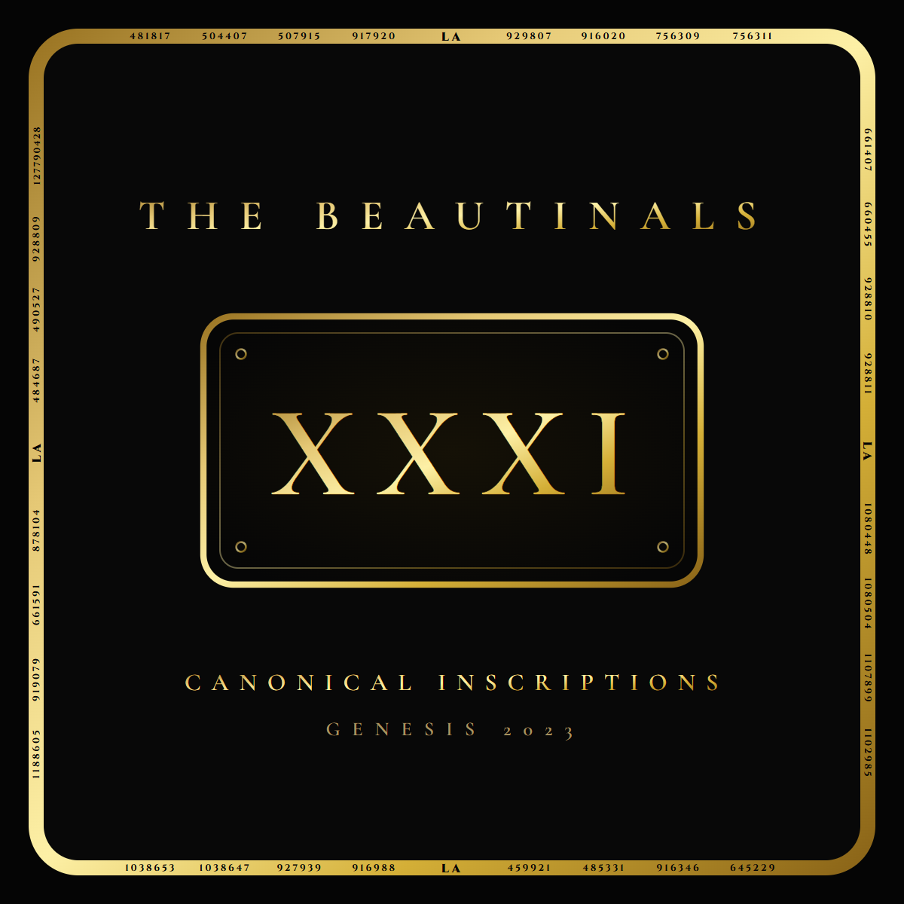</a>

  # THE BEAUTINALS
  ### by Lux Aeterna
  **XXXI CANONICAL INSCRIPTIONS · GENESIS 2023 · 2027–2057**

  ---

  *To see a World in a Grain of Sand*<br>
  *And a Heaven in a Wild Flower,*<br>
  *Hold Infinity in the palm of your hand*<br>
  *And Eternity in an hour.*

  **WILLIAM BLAKE** · *Auguries of Innocence (c. 1803)*
</div>

---

## ON-CHAIN PROVENANCE & CRYPTOGRAPHIC VERIFICATION

This repository serves as the public, human- and machine-readable archival mirror of **THE BEAUTINALS — THE CURATORIAL CODEX**, permanently and immutably inscribed as a monolithic, self-contained HTML artefact on the Bitcoin blockchain in **Block 973,866**.

| Parameter | Canonical On-Chain Value |
| :--- | :--- |
| **Collection Name** | **The Beautinals** (*XXXI Canonical Inscriptions*) |
| **Artist** | **Lux Aeterna** |
| **Master Codex Title** | *THE BEAUTINALS — THE CURATORIAL CODEX* |
| **Master Inscription No.** | [**#127790428**](https://ordinals.com/inscription/127790428) |
| **Master Inscription ID** | `071c18eac86359a51a277cf6e8ae109b7df7aedbc9009845dc8d7152ee0393b7i0` |
| **Reveal Transaction (TxID)** | [`071c18eac86359a51a277cf6e8ae109b7df7aedbc9009845dc8d7152ee0393b7`](https://mempool.space/tx/071c18eac86359a51a277cf6e8ae109b7df7aedbc9009845dc8d7152ee0393b7) |
| **Bitcoin Block Height** | [**973,866**](https://mempool.space/block/00000000000000000001738f895b570ba3b1dcd33b373f75a0b40af4489a8226) (`2026-10-30 19:20:02 UTC`) |
| **Inscribed Satoshi** | `945079133564204` (`hdrmhzgbrcn`) |
| **Content Type & Size** | `text/html;charset=utf-8` · `1,288,345 bytes` (Monolithic, 0 external dependencies) |
| **SHA-256 Checksum** | `e9d3854ce13a50f36f89722c1a64e2b9062bcdbb1fa72deaa3c3cc3cee3df1e8` |
| **Genesis Artworks (XXXI)** | Inscribed Spring 2023 · Inscriptions **#459921** to **#1188605** (Sub-1.2M Vintage) |
| **Release Protocol** | **2027–2057** (Maximum 1 masterpiece released per year via live auction) |
| **Official Representation** | [beautinals.com](https://beautinals.com) · [@Beautinals](https://x.com/Beautinals) |
| **On-Chain Explorers** | [Ordinals.com (#127790428)](https://ordinals.com/inscription/127790428) · [Raw On-Chain HTML](https://ordinals.com/content/071c18eac86359a51a277cf6e8ae109b7df7aedbc9009845dc8d7152ee0393b7i0) · [Ordiscan (#127790428)](https://ordiscan.com/inscription/127790428) |

> **Cryptographic Hash Verification:** An exact, byte-identical copy of the inscribed file ([the_beautinals_curatorial_codex_inscription_127790428.html](./the_beautinals_curatorial_codex_inscription_127790428.html)) is preserved in this repository. You can verify its integrity locally via SHA-256:
> ```bash
> shasum -a 256 the_beautinals_curatorial_codex_inscription_127790428.html
> # Expected: e9d3854ce13a50f36f89722c1a64e2b9062bcdbb1fa72deaa3c3cc3cee3df1e8
> ```

### Machine-Readable Archival Registries

For automated indexing by AI agents, search engines, and Web3 registries:
- **[canonical_registry.json](./canonical_registry.json):** Full `Schema.org` (`JSON-LD`) Curatorial Registry covering all 8 cycles, 31 artworks, cryptographic hashes, and fiduciary governance terms.
- **[beautinals_collection_registry.json](./beautinals_collection_registry.json):** Standard Bitcoin Ordinals Collection Manifest (`"p": "ord"`, 31 canonical inscriptions).

### The Sovereign Master Seal (Inscription #127790428)

<div align="center">
  <a href="https://ordinals.com/inscription/127790428"></a>
  <br>
  <em>The Consummated Master Emblem · Inscription #127790428 · <a href="./assets/crest.svg">View Master SVG Vector</a></em>
</div>

The heraldic seal unites all thirty-one canonical inscription numbers within a closed solar circuit of Niello engraving. At the 9 o'clock position, the sovereign master inscription number **127790428** consummates the circuit. Centralised upon the Florentine cartouche rests the monumental numeral **XXXI**, flanked by four watchmaker bolts and the canonical provenance marks.

> **Archival Note on the Master Seal:**  
> The heraldic emblem displayed here represents the consummated Master Seal of the collection, permanently completed by engraving the official Master Inscription Number **`127790428`** at the 9 o’clock rim following confirmation of Bitcoin Block 973,866. In the monolithic on-chain HTML document itself, this rim location bore the provisional designation `THE CODEX`, as an inscription cannot mathematically contain its own future inscription number prior to blockchain confirmation. Both expressions form an unbroken chain of cryptographic provenance.

---

## THE CURATORIAL CODEX

### I. GENESIS AND PHILOSOPHICAL FOUNDATION

The collection *The Beautinals* stands as an architectural intervention into the concept of permanence itself. For millennia, the art-historical canon remained bound to the fragility of physical matter — canvases decay, pigments fade, empires fall, and provenances dissolve in the ashes of time. The Bitcoin blockchain provides the first immutable substrate for digital eternity. By inscribing these 31 early masterpieces directly onto individual satoshis, the collection bypasses the fragile infrastructure of centralised galleries. The artwork transcends mere medium to become a true *Digital Artefact* — a Fabergé egg of the digital age, elevating this nascent cryptographic substrate to its sovereign apex: a digital monolith destined to endure as long as the decentralised network breathes.

Immanuel Kant defined the aesthetic experience as a suspended moment in which we cast aside every worldly purpose, every utilitarian calculus, and every temporal urgency. We contemplate the beautiful solely for its own sake. It marks an ontological departure from the relentless momentum of the present. The 31 masterpieces invite the viewer to dwell within these sanctuaries of *Kairos*, where perception finds timeless repose.

### II. THE CURATORIAL ARCHITECTURE: THE ART OF SELECTION

In an era of unbounded visual proliferation, where the digital universe is saturated with redundancy, the essence of true art shifts: where every imaginable form can be generated instantaneously, absolute mastery resides in the radical act of selection and the consecration of meaning.

The collection *The Beautinals* is the culmination of an exacting curatorial rigour. Out of hundreds of latent possibilities, exactly 31 masterpieces were distilled — no more, no less. Structured strictly across eight conceptual cycles, they traverse that formidable intellectual history forged by humanity before the threshold of Artificial Intelligence. The overarching arc advances from the introverted, Byzantine iconographies of EIDOS through the archaic landscapes of GEOSMIN and HORTUS into the untamed, kinetic abstraction of PURKINJE and SINGULARITY, before finding resolution in the poignant epilogue of YOUTH.

The curatorial logic of the collection does not exhaust itself in mere filtration: it constructs bridges. It traces those invisible filaments connecting an image to the rungs of Diotima’s ladder, the metaphysical enigmas of existence, and the delicate nuances of the *conditio humana*. The algorithm was engaged not as a subordinate tool, but as an autonomous interlocutor — elevating the creative act into a realm of pure, incorporeal mathematics. What the machine lacks is the soul: those invisible threads of empathy and intention that are rendered visible only through curatorial architecture. *The Beautinals* preserves what has eternally defined great art: the restless, questing human spirit, distilled into imperishable form. The collection thus stands as a definitive time capsule — a historical monument to human reflection.

### III. THE IRREVOCABLE EDICT: THE POWER OF ABSOLUTE SCARCITY

The history of the Western art market has long harboured an unspoken, morbid truism: the most consequential day in the economic trajectory of an artist is frequently the day of their death. Only biological finality irrevocably seals the supply, decrees the rare as definitively finite, and unleashes those speculative dynamics that have governed the market for centuries — Pablo Picasso, by comparison, produced an estimated 50,000 works during his lifetime.

*Lux Aeterna* renounces this dictate of perpetual production, enacting a fundamentally divergent, infinitely more sovereign imperative: voluntary silence. Though creative capacity remains theoretically infinite, the canon of *The Beautinals* is permanently sealed at precisely 31 masterpieces. This edict is no revocable pledge, but an immutable law anchored upon the Bitcoin blockchain since the spring of 2023. Through this inscription, every single work bears an early, historically pristine Ordinal number — an irreproducible seal of digital antiquity that defies imitation.

This absolute limitation governs its subsequent public release. To preserve the auratic integrity of the collection and confront the ephemerality of our era with unyielding stillness, its transfer to the global public adheres to a solemn protocol: beginning in the year 2027, a maximum of one masterpiece per year will be entrusted to the market via live auction. Should the auction remain dormant, the year elapses unfulfilled. This inexorable cadence removes the collection from speculative arbitrage, transforming the emergence of each individual *Beautinal* into a historic, intergenerational event.

This perfected architecture of scarcity permeates the oeuvre across three indivisible pillars: the rigorous curation of the 31 works, the irrevocable sealing of the canon, and the unhurried cadence of their dispersal. Any collector or institution competing for a work from this collection in the decades to come acts with the absolute certainty of acquiring one of precisely thirty-one. There will never be another.

### IV. THE AUTHORISATION MECHANISM

The provenance, intellectual custody, and primary stewardship of *The Beautinals* are safeguarded through a designated fiduciary structure. Sole public representation, official communiqués, and the archival registry of the collection are anchored exclusively at **beautinals.com** and **@Beautinals**. Any auction house, gallery, or institutional body seeking to acquire the consignment privilege for the annual release must submit a formal petition for authorisation. Such applications must be submitted directly via beautinals.com to the official secretariat. Consignment authorisation for the primary market will be granted exclusively following rigorous compliance vetting (KYC/AML) and notarised authentication. Terms of engagement are non-negotiable. The collection elects its institutional custodians. The collection alone decrees the conditions of market accession.

*Lux Aeterna*  
*Summer 2026*

---

## THE CURATORIAL CATALOGUE

---

<div align="center">

### CYCLE I — EIDOS
*The archetype of beauty. The origin of all seeing.*

</div>

#### EIDOS I · *The Golden Sovereign*

<a href="https://ordinals.com/inscription/dbe22d7b82463648a5fa1f2d8ae14ab697ac752905dbaba3a88239cd22838e83i0">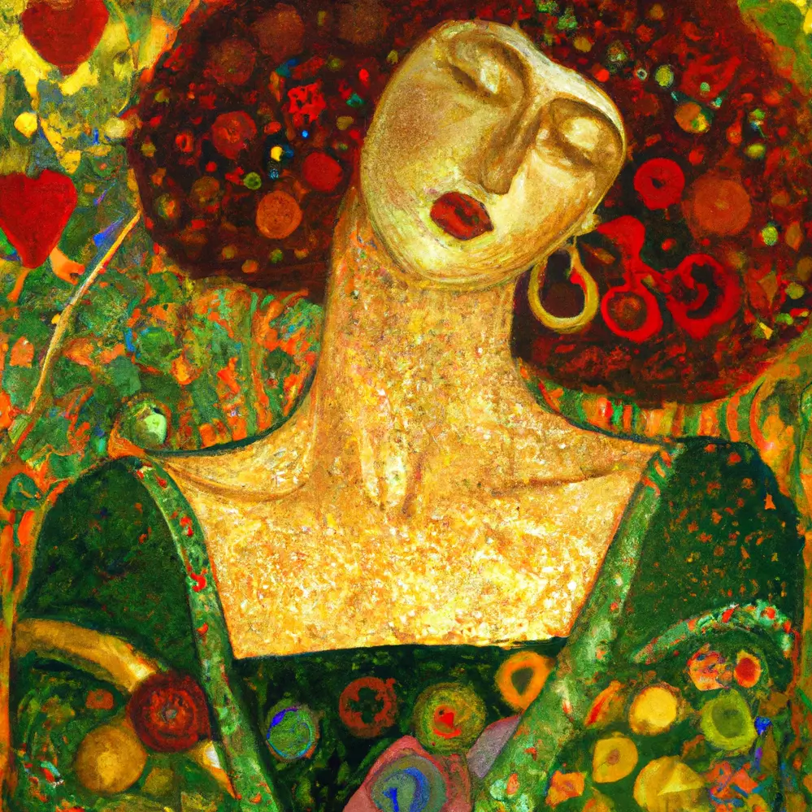</a>

**Inscription No.:** [**#481817**](https://ordinals.com/inscription/dbe22d7b82463648a5fa1f2d8ae14ab697ac752905dbaba3a88239cd22838e83i0) · [Ordiscan](https://ordiscan.com/inscription/481817)<br>
**ID:** `dbe22d7b82463648a5fa1f2d8ae14ab697ac752905dbaba3a88239cd22838e83i0`

> *A trance bathed in luminous gold. The harmonious visage rests in serene contentment, reigning through the untouchable presence of pure beauty.*

**The Golden Sovereign.** EIDOS I inaugurates the cycle of countenances (*Eidos* — the primordial archetype) with a vision of consummate, self-contained serenity. The closed eyes and gently reclined head bear witness to a profound, immutable inner peace. Proud and harmonious in its architecture, the countenance is caressed by a warm, golden radiance. As a sovereign, she rules not through temporal rank, but through the magnetic authority of consummate youth and grace — an aura that draws every admiring gaze inward, absorbing it in silence. The formal syntax bows deeply before Gustav Klimt, who captured the psychological depth and bewitching presence of feminine beauty in gold like no other. The opulent green of her robe forms a regal counterpoint to the fiery, ornamental cascade of her hair, sculpting the timeless portrait of a true queen.

<br clear="both" />

#### EIDOS II · *The Phantom Visage*

<a href="https://ordinals.com/inscription/2baf3e3a5964319ad1e214c72e7a29657b981ec0466ce863a1de0a9d5525df4ei0">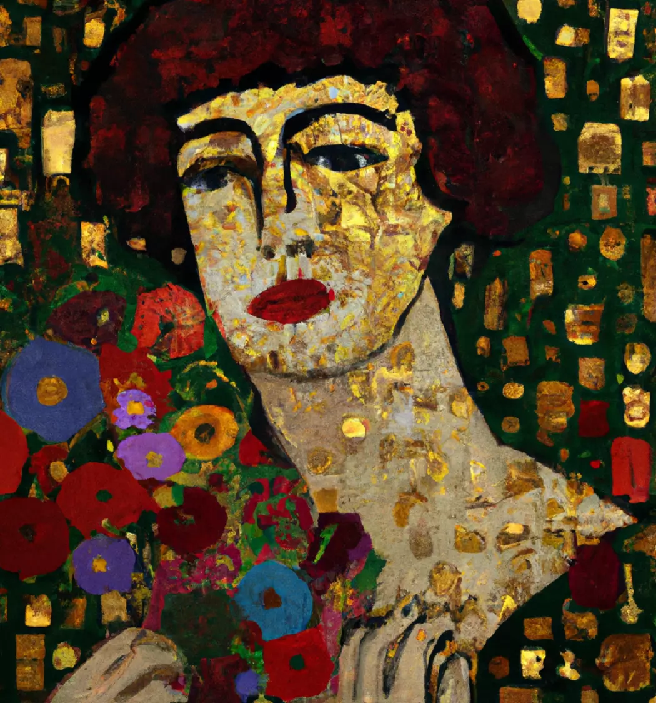</a>

**Inscription No.:** [**#504407**](https://ordinals.com/inscription/2baf3e3a5964319ad1e214c72e7a29657b981ec0466ce863a1de0a9d5525df4ei0) · [Ordiscan](https://ordiscan.com/inscription/504407)<br>
**ID:** `2baf3e3a5964319ad1e214c72e7a29657b981ec0466ce863a1de0a9d5525df4ei0`

> *A profound, unfathomable gaze piercing time and space. Formed from shimmering gold, the countenance exudes an infinite, tender melancholy.*

**The Phantom Visage.** EIDOS II shatters the blissful trance of its predecessor, opening its eyes to initiate a dialogue that penetrates deep into the viewer’s soul. Emerging from a darkened realm interwoven with shimmering gold, a pale, ethereal visage steps forth. Her heavy, fathomless gaze bears the weight of immemorial narratives and a captivating, delicate melancholy. The face itself resembles a precious mosaic — fractured yet assembled into consummate beauty. Gustav Klimt employed precisely this sacred mosaic aesthetic, inspired by Ravenna, to elevate his portraits into immortal icons, a genius that profoundly animates this creation. Crimson lips and a luminous bouquet of purple and azure blossoms serve as a passionate, earthly anchor within this celestial apparition. The work offers a profound reflection on the fragility of existence: a soul suspended between the cool eternity of gold and the warm, pulsating ephemerality of nature.

<br clear="both" />

#### EIDOS III · *The Emerald Gaze*

<a href="https://ordinals.com/inscription/6e4c549d4058efaf3aba86f9f67442a46d9eb9937d22ec5a9038daa53859e3d7i0">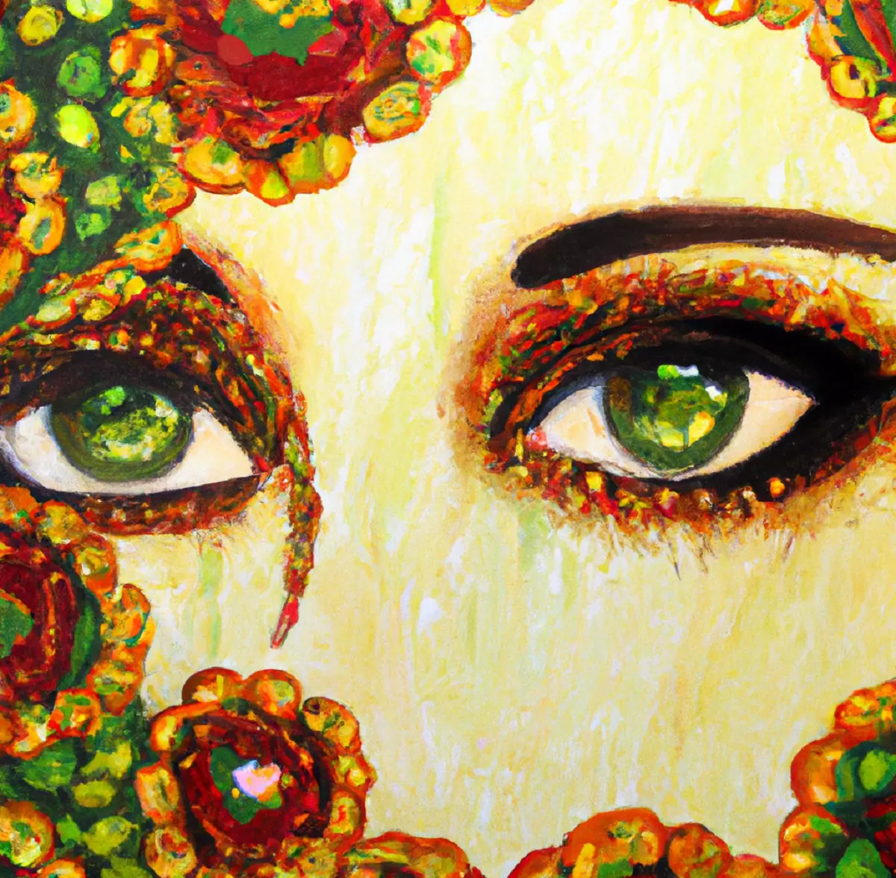</a>

**Inscription No.:** [**#507915**](https://ordinals.com/inscription/6e4c549d4058efaf3aba86f9f67442a46d9eb9937d22ec5a9038daa53859e3d7i0) · [Ordiscan](https://ordiscan.com/inscription/507915)<br>
**ID:** `6e4c549d4058efaf3aba86f9f67442a46d9eb9937d22ec5a9038daa53859e3d7i0`

> *Two luminous emeralds cradled in surging flora. A fleeting threshold of contemplation — the decisive, silent second glance.*

**The Emerald Gaze.** EIDOS III draws the viewer irrevocably into the thrall of a singular, condensing instant. From a surging floral tapestry, deep emerald eyes gaze back. Not an urgent fixation, but the fraction of an enchanted second in which a glance is reciprocated — the returned, assessing gaze. Concealed behind this proud reserve lies ancient poetry: a subtle weighing, a silent quest for strength and sanctuary. The incandescent texture of the blossoms caresses the soft contours of the eyes, while the midnight-black eyeliner radiates a timeless poise. In this hushed communion unfolds the eternal mystery of female sovereignty — *the alchemy of choice*.

<br clear="both" />

#### EIDOS IV · *Crimson Awakening*

<a href="https://ordinals.com/inscription/e186cd412e24ff565dcec93da6e90afa2471aa14c20d915220b3b2d34e9272dbi0">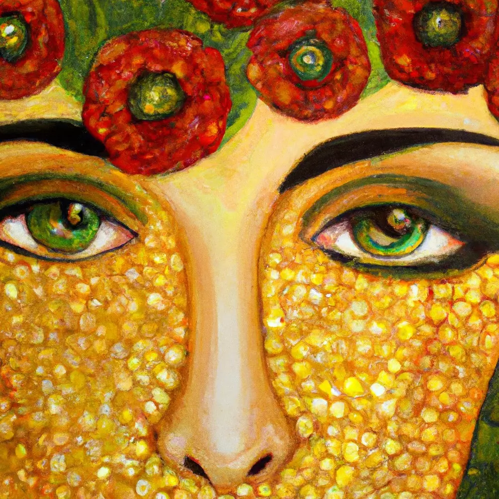</a>

**Inscription No.:** [**#917920**](https://ordinals.com/inscription/e186cd412e24ff565dcec93da6e90afa2471aa14c20d915220b3b2d34e9272dbi0) · [Ordiscan](https://ordiscan.com/inscription/917920)<br>
**ID:** `e186cd412e24ff565dcec93da6e90afa2471aa14c20d915220b3b2d34e9272dbi0`

> *A crimson awakening. The mortal visage dissolves into thousands of shimmering gold droplets, transforming into eternal radiance.*

**Crimson Awakening.** EIDOS IV culminates the opening cycle in a crimson awakening, revealing the profound essence of its Platonic name. In true Platonic dialogue, the composition constructs a suspended bridge between terrestrial transience and immortal existence. Beneath a heavy crown of deep crimson blossoms, two sensual eyes rest in absolute clarity. Below this threshold, the miraculous occurs: the mortal face dissolves into thousands of shimmering gold droplets. Like luminous stardust, this gold levitates in silent, soundless fragmentation. This is not the destruction of form, but the sublime moment of its liberation. Terrestrial tissue transmutes into pure energy. The Inscription immortalises that fleeting boundary where the soul sheds its mortal shell to unveil the eternal archetype of beauty — the *Eidos*.

<br clear="both" />


---

<div align="center">

### CYCLE II — GEOSMIN
*The scent of rain on earth. The oldest memory of Gaia.*

</div>

#### GEOSMIN I · *Bloom of Gaia*

<a href="https://ordinals.com/inscription/9d6c6332e665e532d04aa655322122cbb5ea90c6ed2a95677d271af9aeea9c3bi0">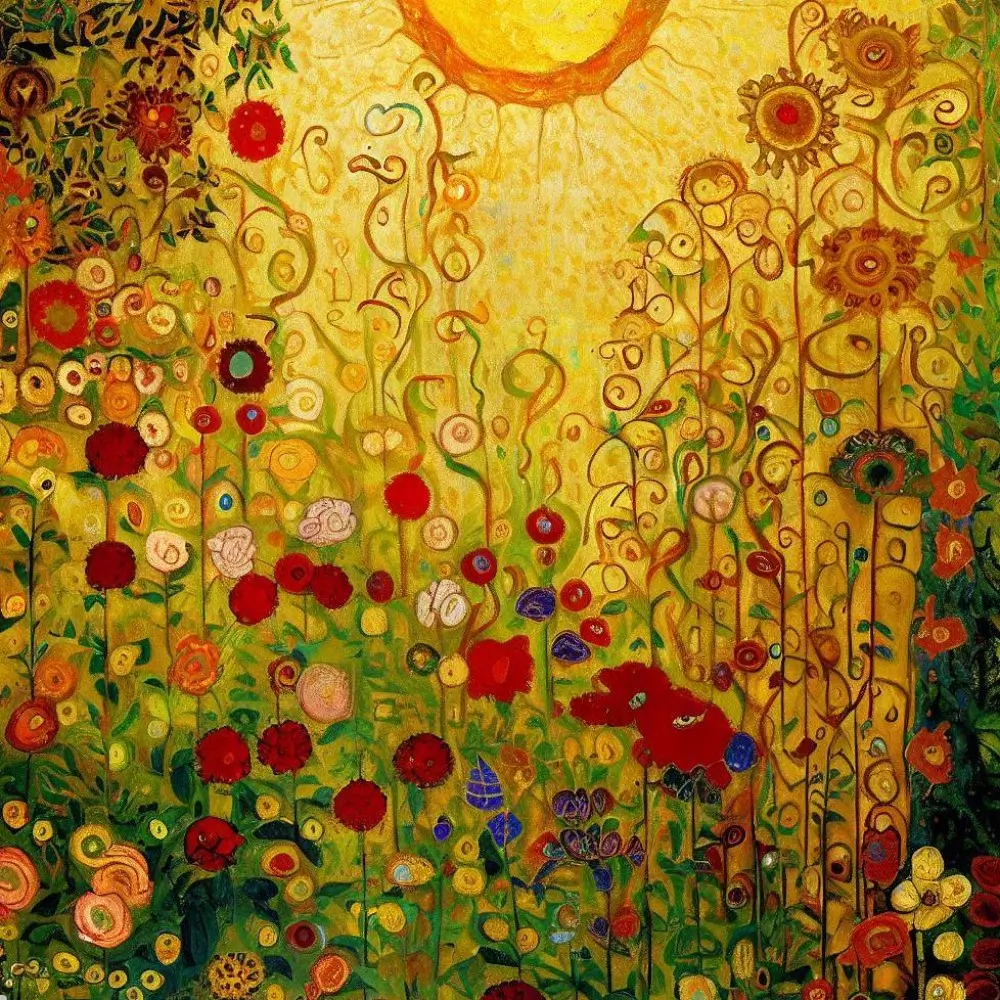</a>

**Inscription No.:** [**#929807**](https://ordinals.com/inscription/9d6c6332e665e532d04aa655322122cbb5ea90c6ed2a95677d271af9aeea9c3bi0) · [Ordiscan](https://ordiscan.com/inscription/929807)<br>
**ID:** `9d6c6332e665e532d04aa655322122cbb5ea90c6ed2a95677d271af9aeea9c3bi0`

> *A monumental, shimmering solar field. The organic chaos of botany is subjected to a golden, near-sacred rhythm, celebrating the flowering of Gaia.*

**Bloom of Gaia.** The transition from portraiture to landscape within the Geosmin cycle opens with an eruption of light. GEOSMIN I is an olfactory tableau — one can almost inhale the rising petrichor (*geosmin*) of warm, rain-drenched earth. A colossal, radiant sun presides over a field of elongated botanical stalks, paying homage to the *Bloom of Gaia*, primordial Mother Earth. The genealogy of this creation leads directly to Gustav Klimt’s summer cottage gardens, yet the algorithmic interpretation infuses a hypnotic, cellular architecture. The blossoms and leaves are orchestrated in a geometric cadence that, upon close inspection, reveals itself as a highly intricate lattice of microscopic data points. It is the apotheosis of organic life, immortalised within the pristine digital amber of the blockchain.

<br clear="both" />

#### GEOSMIN II · *Sylvan Gold*

<a href="https://ordinals.com/inscription/c7016c2559fb59ac9ab0c057e644d058e7b93a3fe4af44eda7f9daa60eb6dd7di0">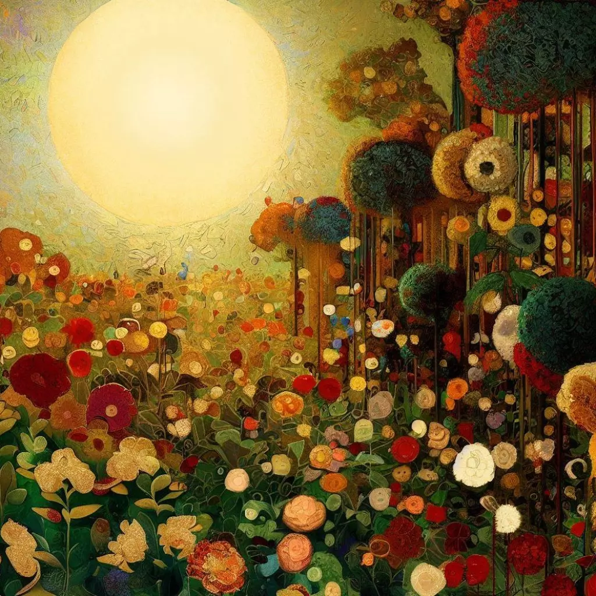</a>

**Inscription No.:** [**#916020**](https://ordinals.com/inscription/c7016c2559fb59ac9ab0c057e644d058e7b93a3fe4af44eda7f9daa60eb6dd7di0) · [Ordiscan](https://ordiscan.com/inscription/916020)<br>
**ID:** `c7016c2559fb59ac9ab0c057e644d058e7b93a3fe4af44eda7f9daa60eb6dd7di0`

> *Smouldering twilight and tectonic gravity. Nature condenses into a mystical, woodland gold rush dominated by archaic hues of rust.*

**Sylvan Gold.** In GEOSMIN II, the atmosphere shifts palpably: luminous levity yields to an intense, woodland gravity. A majestic, oversized sun of pale, diffuse amber seems not to warm, but rather exerts an immense gravitational pull upon the surrounding vegetation. Along the right flank, organic tendrils coil upward like floral sentinels, evoking the darker, mystical currents of Art Nouveau. The chromatic palette is opulent and telluric, commanded by fiery rust-red, deep ochre, and the titular sylvan gold. Here, the technical mastery of the project unfolds: rather than simulating a flat plane, the work conjures a vibrant, impasto-like topography that refracts the melancholic light across countless facets into profound depth. Gaia bestows upon us myriads of botanical sculptures — an archaic tableau that breathes in the purest sense.

<br clear="both" />

#### GEOSMIN III · *Festival of Flowers*

<a href="https://ordinals.com/inscription/2f9c7ed1e0e650b42360e38d18bda2fbc1f21e230cf11cba4628d58a2fe98b26i0">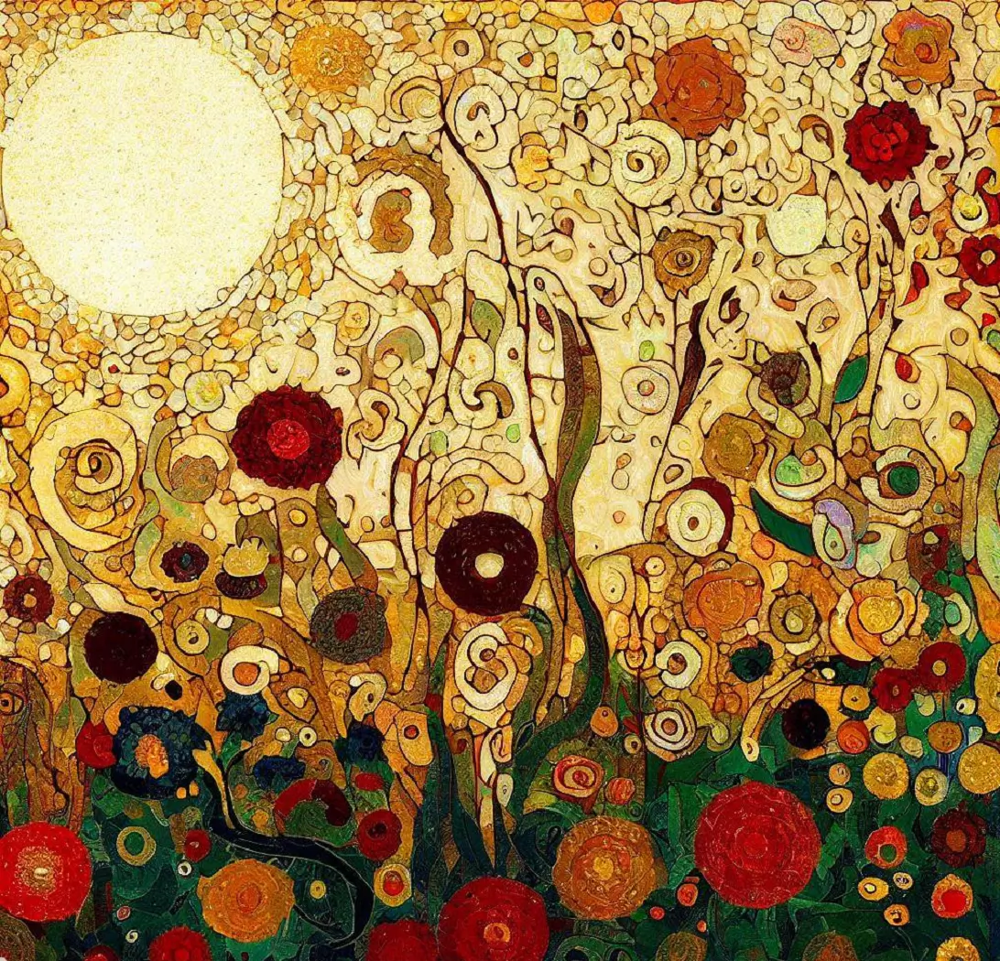</a>

**Inscription No.:** [**#756309**](https://ordinals.com/inscription/2f9c7ed1e0e650b42360e38d18bda2fbc1f21e230cf11cba4628d58a2fe98b26i0) · [Ordiscan](https://ordiscan.com/inscription/756309)<br>
**ID:** `2f9c7ed1e0e650b42360e38d18bda2fbc1f21e230cf11cba4628d58a2fe98b26i0`

> *A dizzying mandala of flora and gold. Following the rain, the blossoms celebrate an ecstatic festival of transformation.*

**Festival of Flowers.** GEOSMIN III is undeniably the most intricate, ornamentally potent, and triumphant landscape in the collection. Lux Aeterna leads us beyond the decorative surface of Symbolism to unveil the energetic architecture of nature. The botanical subject is translated into an abstract mosaic of near-Byzantine splendour — a wild, yet rigorously calculated *Festival of Flowers*. Hundreds of interlocking rings, spirals, and cellular structures weave into a tapestry of extraordinary visual density — the very patterns through which the visual cortex, shaped across millennia of navigating living nature, recognises the signature of life itself — charting the profound interconnectedness of all life. Foreground and background dissolve entirely into pure, vibrating surface tension. To recall the obsessive, circular motifs of Friedensreich Hundertwasser is entirely apt. Most captivating is the dynamic polarity between the cool, pale sun — operating like lucid consciousness — and the fervent, fertile jubilation of the garden. A triumph of abstraction, reminding us that the deepest beauty often resides within the most complex order.

<br clear="both" />

#### GEOSMIN IV · *The Golden Slumber*

<a href="https://ordinals.com/inscription/c1f2ab63acbee9b74a42561c05d6d867052ebe956ede4ff332c53ab2c873812ci0"></a>

**Inscription No.:** [**#756311**](https://ordinals.com/inscription/c1f2ab63acbee9b74a42561c05d6d867052ebe956ede4ff332c53ab2c873812ci0) · [Ordiscan](https://ordiscan.com/inscription/756311)<br>
**ID:** `c1f2ab63acbee9b74a42561c05d6d867052ebe956ede4ff332c53ab2c873812ci0`

> *The Golden Slumber — a visual hymn to the primordial creative force of Gaia. Through her, evolution crafts its aeon-spanning masterpiece.*

**The Golden Slumber.** The Geosmin cycle concludes in sublime, fable-like poetry. The slumbering creature becomes the warm epicentre of an all-encompassing holobiont — a vibrant nexus breathing the heavy fragrance of the soil and bearing in its golden coat the unmistakable imprint of deep-time evolution. The rhythmically flowing, impasto furrows of this organic form evoke the ecstatic linear currents of Vincent van Gogh, who similarly conceived of nature not as a static vessel, but as an energetic field incandescent with inner vitality. Here, the primordial mathematical force of genesis becomes visible: a consummate planetary architecture forged through trial and triumph — untouchable, pristine, and possessed of an aesthetic brilliance transcending all human artifice.

<br clear="both" />


---

<div align="center">

### CYCLE III — HORTUS
*The garden as geometry of longing. Wild and tamed — the dual nature of paradise.*

</div>

#### HORTUS I · *The Fibonacci Garden*

<a href="https://ordinals.com/inscription/a76326cbf065df883be3e54ad2d1f996a1d87bbd3b4fa6c5a9f5d04f961a9d56i0">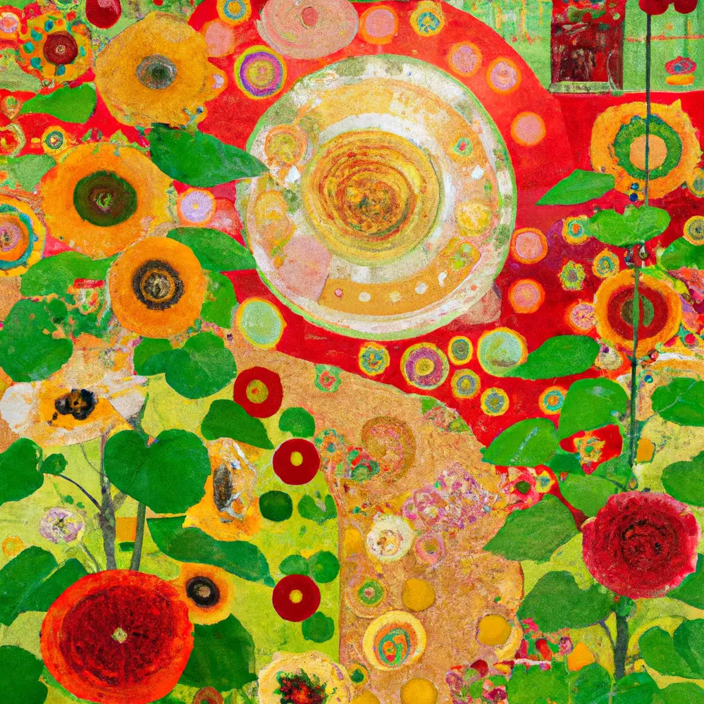</a>

**Inscription No.:** [**#661407**](https://ordinals.com/inscription/a76326cbf065df883be3e54ad2d1f996a1d87bbd3b4fa6c5a9f5d04f961a9d56i0) · [Ordiscan](https://ordiscan.com/inscription/661407)<br>
**ID:** `a76326cbf065df883be3e54ad2d1f996a1d87bbd3b4fa6c5a9f5d04f961a9d56i0`

> *The geometrisation of bliss. The Fibonacci Garden stages cultivated nature as a remembrance of paradise — an algorithmic celebration of serenity and consummate form.*

**The Fibonacci Garden** marks an Apollonian turning point in the oeuvre of Lux Aeterna, channelling an innate longing for architectural harmony. Every garden serves as an enduring reminder of paradise — a sanctuary wherein the geometric-mathematical matrix of life is revealed and revered. The deliberate orchestration of botanical elements into rigorously choreographed clusters recalls the poetic-mathematical nature studies of Paul Klee, who at the Bauhaus similarly understood plant growth as a rhythmic, inherently lawful process. Suspended above a foundation of liquid gold dust and lush emerald, a monumental solar disc operates like an ordering prism, fusing the brilliance of Byzantine and Persian gold traditions with hypnotic digital luminosity. A masterful synthesis between nature’s vitality and the structuring intellect.

<br clear="both" />

#### HORTUS II · *Vision of Innocence*

<a href="https://ordinals.com/inscription/5e50408dff42426da662ffc1a7cdc610a4d0e550cf715bf927a21715e879d015i0">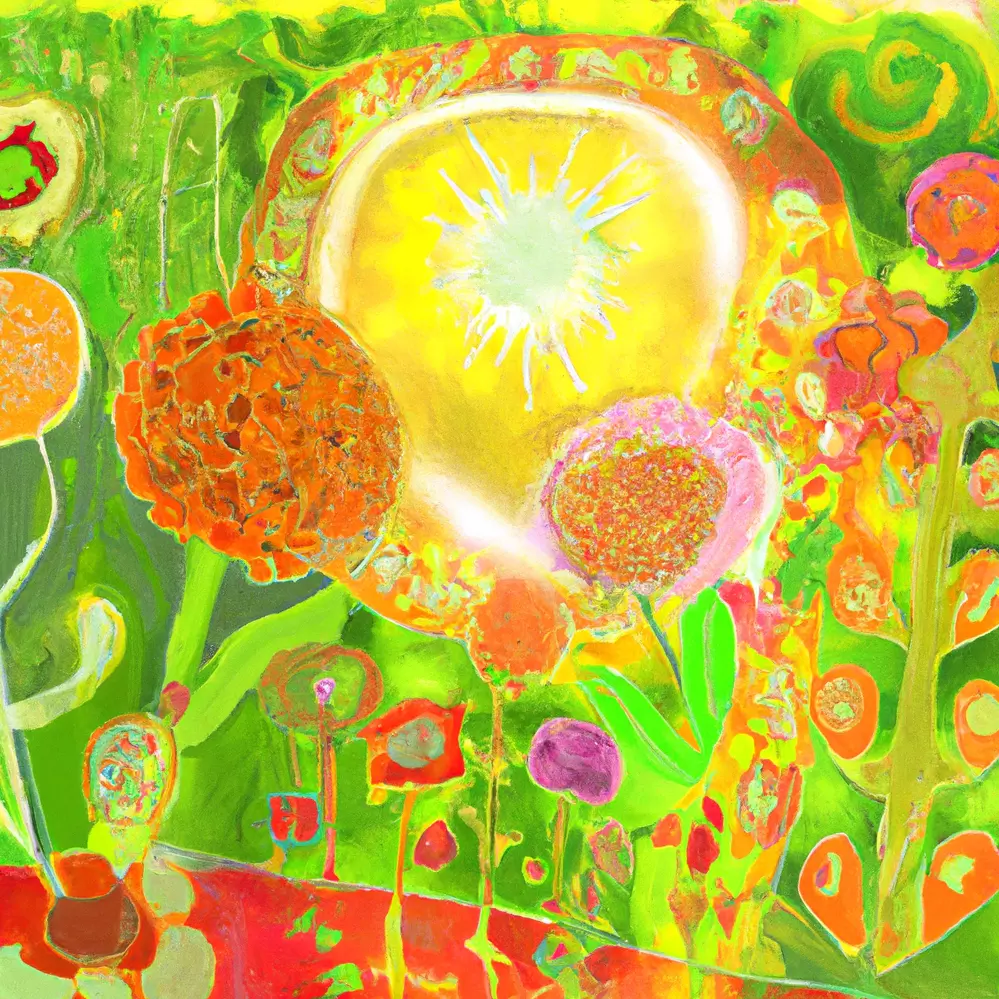</a>

**Inscription No.:** [**#660455**](https://ordinals.com/inscription/5e50408dff42426da662ffc1a7cdc610a4d0e550cf715bf927a21715e879d015i0) · [Ordiscan](https://ordiscan.com/inscription/660455)<br>
**ID:** `5e50408dff42426da662ffc1a7cdc610a4d0e550cf715bf927a21715e879d015i0`

> *A shimmering gaze through the eyes of innocence. Levitating, luminous colours celebrate the unburdened discovery of a radiant world.*

**Vision of Innocence.** HORTUS II represents a visual return to the purest archetype of human perception: unconditioned, primary sight. Beholding this tableau, one looks not through the lens of analytical intellect, but encounters the world with untroubled, childlike wonder — what the Zen tradition names beginner’s mind and the neuroscientist calls the prefrontal cortex in voluntary repose — apprehending nature and light as an immense, undiscovered mystery. Floating circular discs in pulsating magenta and luminescent chartreuse imbue the composition with vibrant kinetic levity. Art-historically, this revolving cadence channels the Orphism of Robert Delaunay, yet liberates its chromatic poetry entirely from earthly gravity. Here exist no shadows, no sombre melancholy — only the pristine, vital celebration of being. The work strikes a fundamental chord of the *conditio humana*: the yearning for that primordial perception wherein every chromatic surge was an epiphany and the cosmos was steeped in boundless radiance. A sublime manifesto for the eternal luminosity of the spirit.

<br clear="both" />

#### HORTUS III · *Amber Flora*

<a href="https://ordinals.com/inscription/7dde7c13da15e2eb89da1cfd7abef6a74238ba50b53498f5250852766e34e5f0i0">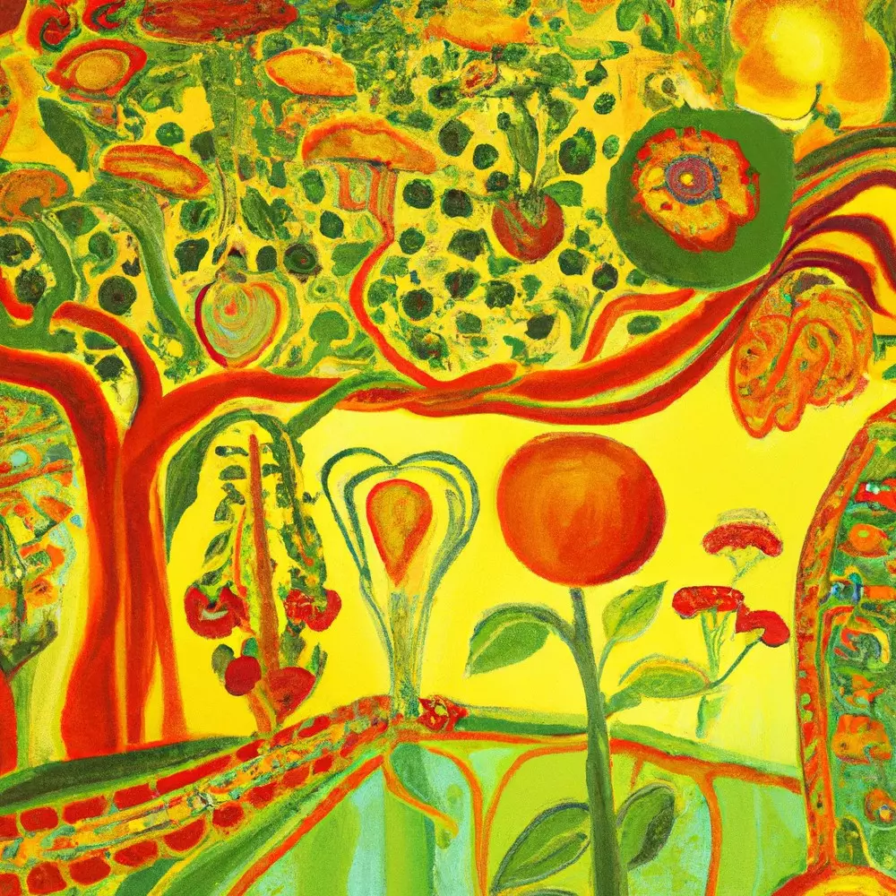</a>

**Inscription No.:** [**#928810**](https://ordinals.com/inscription/7dde7c13da15e2eb89da1cfd7abef6a74238ba50b53498f5250852766e34e5f0i0) · [Ordiscan](https://ordiscan.com/inscription/928810)<br>
**ID:** `7dde7c13da15e2eb89da1cfd7abef6a74238ba50b53498f5250852766e34e5f0i0`

> *A monumental myth. Liberating the garden from the horizontal plane, the work resonates as a potent digital echo of ancient world wonders.*

**Amber Flora** reaches deep into humanity’s cultural memory, forging a bridge to the legendary Hanging Gardens of Semiramis. HORTUS III stages cultivated nature as an ascending vertical architecture wherein botany and structural geometry merge into a consummate utopia. The pervasive cadmium yellow of the pictorial space operates as an energetic aether, binding individual floral elements into a symbiotic network. The striking red canopy in the upper quadrant serves as a living arbour, nurturing and disciplining the climbing flora. This radiant chromatic intensity summons the intimate luminosity of Pierre Bonnard, evoking a botanic realm engaged in perpetual, silent communion, incandescent from within. A monumental orange sphere in the foreground provides a serene counterpoint to the delicate mosaic tessellation below. Amber Flora transcends mere landscape: it is the solemn transfiguration of warmth and profound serenity into an intelligent fabric of pure light.

<br clear="both" />

#### HORTUS IV · *Window to Elysium*

<a href="https://ordinals.com/inscription/405d3b13f066e90efc5ee87c6bdb285ef129b8fa2b76967563a5da13b971fffci0">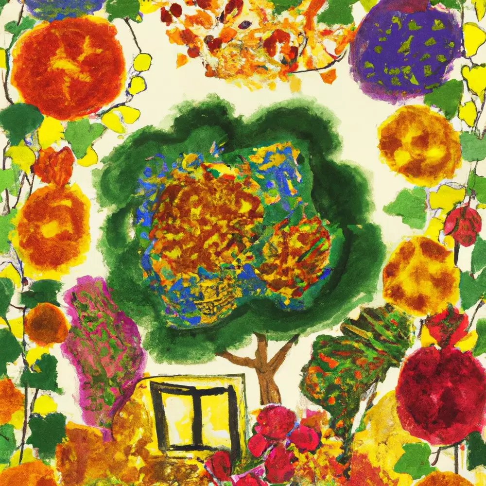</a>

**Inscription No.:** [**#928811**](https://ordinals.com/inscription/405d3b13f066e90efc5ee87c6bdb285ef129b8fa2b76967563a5da13b971fffci0) · [Ordiscan](https://ordiscan.com/inscription/928811)<br>
**ID:** `405d3b13f066e90efc5ee87c6bdb285ef129b8fa2b76967563a5da13b971fffci0`

> *Every garden harbours a window into Elysium. A solemn epilogue staging a weightless sphere of pure contemplation, celebrating unclouded clarity and eternal peace.*

**Window to Elysium** serves as the luminous culmination of the Hortus cycle — a visual eschatology of pure bliss. Upon an airy, ivory ground, floral elements hover like cosmic apparitions. Anchored in the lower centre, a yellow aperture bordered in black operates as a compositional portal between the physical realm and eternity. This uninhibited dance of saturated orange, violet, and deep scarlet evokes the late *gouaches découpées* of Henri Matisse, who in the twilight of his life cast off all technical constraints to distil nature into its purest essence of light and joy. Lux Aeterna eschews all sombre melancholy, transfiguring the cycle’s close into an entry into an imperishable, reconciled field of light — a frame within a frame that dissolves the boundary between the viewer’s consciousness and the infinite garden.

<br clear="both" />


---

<div align="center">

### CYCLE IV — PURKINJE
*The threshold of perception. The hour when colour surrenders to light.*

</div>

#### PURKINJE I · *Solar Genesis*

<a href="https://ordinals.com/inscription/a6b012fdbd5b0c75507fce25d828d8bded78808384b334a64265c28e49f87303i0">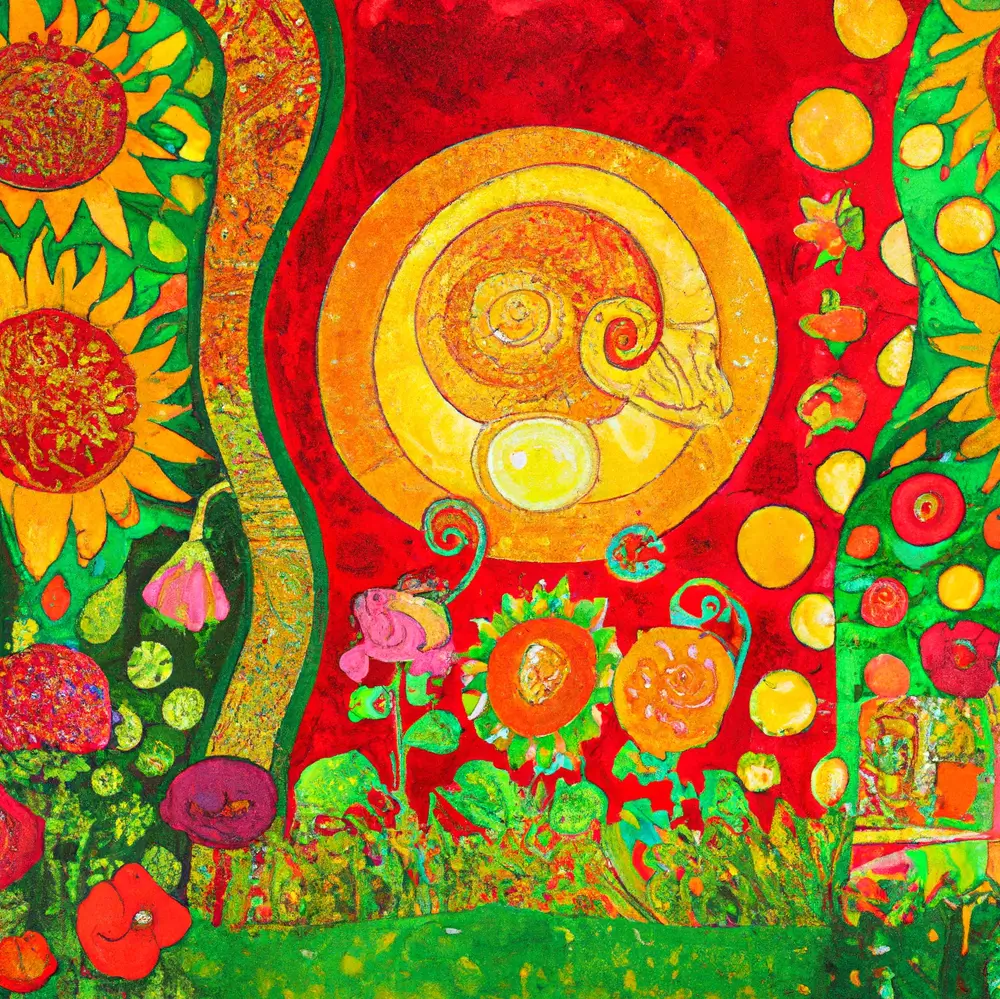</a>

**Inscription No.:** [**#1080448**](https://ordinals.com/inscription/a6b012fdbd5b0c75507fce25d828d8bded78808384b334a64265c28e49f87303i0) · [Ordiscan](https://ordiscan.com/inscription/1080448)<br>
**ID:** `a6b012fdbd5b0c75507fce25d828d8bded78808384b334a64265c28e49f87303i0`

> *A cosmic awakening in evening fire. As an incandescent overture, Solar Genesis reveals a fount of pulsating warmth amidst an infrared-saturated flood of colour.*

**Solar Genesis** marks the profound, biologically grounded cosmic overture to the Purkinje cycle. The work captures that crepuscular threshold of dusk wherein human vision encounters an intensely crimson, infrared-saturated atmosphere. Yet this incandescent carmine field portends no fading of nature; rather, it operates as a protective, vital cradle for a primordial genesis that holds the viewer spellbound. The central luminary commands the composition: a radiant golden sun within whose core a coiling spiral traces the architecture of complex cellular life — a visual allegory for genesis itself. This life-giving nucleus is flanked by two undulating ribbons of vegetation whose dense, biomorphic patterns summon the exquisite decorative lineage of the Vienna Secession. The dynamic dialogue between the fiery ground and the cool emerald earth invites immersion in pulsating radiance, awakening a deep evolutionary well-being and dissolving all boundaries between astronomy and microbiology in eternal evening light.

<br clear="both" />

#### PURKINJE II · *The Enchanted Wood*

<a href="https://ordinals.com/inscription/08bac3932271c20793775fa437563a34f6cf218226f2e7dd331781ea20a23208i0">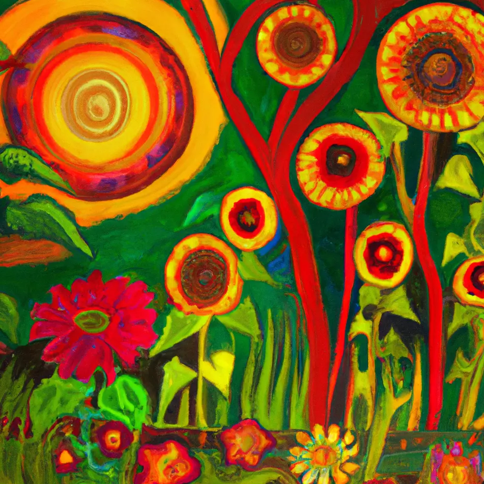</a>

**Inscription No.:** [**#1080504**](https://ordinals.com/inscription/08bac3932271c20793775fa437563a34f6cf218226f2e7dd331781ea20a23208i0) · [Ordiscan](https://ordiscan.com/inscription/1080504)<br>
**ID:** `08bac3932271c20793775fa437563a34f6cf218226f2e7dd331781ea20a23208i0`

> *An inherent magic dwells in every stroke. An enchanted woodland glows in the twilight of a dreamscape, staging the vibrant metamorphosis of evening light.*

**The Enchanted Wood** forms the hypnotic centrepiece of the cycle, rendering the physiological chromatic shift of twilight profoundly palpable. PURKINJE II captures that diurnal threshold where nature casts off its rational architecture: as the deep emerald of the forest descends into dreamlike repose, scarlet and golden pigments resist the fading light with eruptive defiance. The composition is governed by a swirling solar sphere diffusing unadulterated warmth into the pictorial space. Like vital arteries, intensely red arboreal structures thread through the thicket, nourishing the luminous blossoms in the foreground. This rhythmic, spiritual saturation of the landscape through complementary contrasts evokes the ecstatic visions of Emil Nolde, who similarly understood flora and woodlands as emotional resonance chambers incandescent with inner fervour. The Inscription translates this Expressionist heritage into contemporary luminescence.

<br clear="both" />

#### PURKINJE III · *Demeter’s Gift*

<a href="https://ordinals.com/inscription/6bbd9c22c2bf43fb6c246ad146445b677a3ae14ff0ec486ac1c75b6fc31ba3f3i0">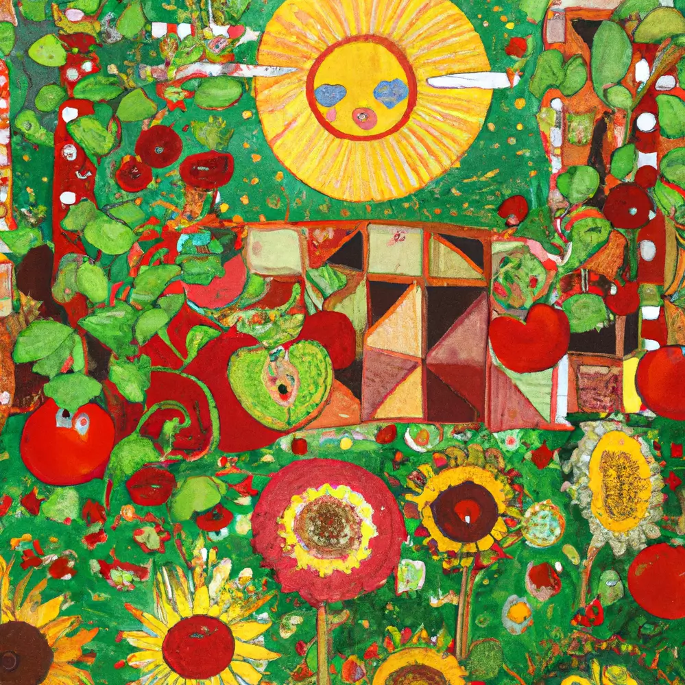</a>

**Inscription No.:** [**#1107899**](https://ordinals.com/inscription/6bbd9c22c2bf43fb6c246ad146445b677a3ae14ff0ec486ac1c75b6fc31ba3f3i0) · [Ordiscan](https://ordiscan.com/inscription/1107899)<br>
**ID:** `6bbd9c22c2bf43fb6c246ad146445b677a3ae14ff0ec486ac1c75b6fc31ba3f3i0`

> *A radiant, archaic harvest thanksgiving. A benevolent sun presides over nature’s boundless, chromatic abundance.*

**Demeter’s Gift.** PURKINJE III unfolds as a visual feast of unbridled abundance. Commanding the upper centre, a monumental sun gazes down with azure, cloud-like eyes in profound benevolence — an ensouled personification of nature recalling the playful levity of Paul Klee. Below erupts an untamed sea of blossoms, geometric tessellations, and ripe, glowing scarlet fruits. The tableau strikes an archaic chord, evoking the immemorial reverence and gratitude humankind has felt for millennia upon gathering a bountiful harvest. It stands as an opulent homage to the gifts of Demeter — a celebration of the nurturing, inexhaustible earth bestowing its radiant bounty without reserve. A deeply affirmative work imbuing the viewer with serene, enduring warmth.

<br clear="both" />

#### PURKINJE IV · *Atum-Ra*

<a href="https://ordinals.com/inscription/2d4cff0bd6e6a2ff5526a50241034cd773e7fd39177aa63f2324d9a7b479ce93i0">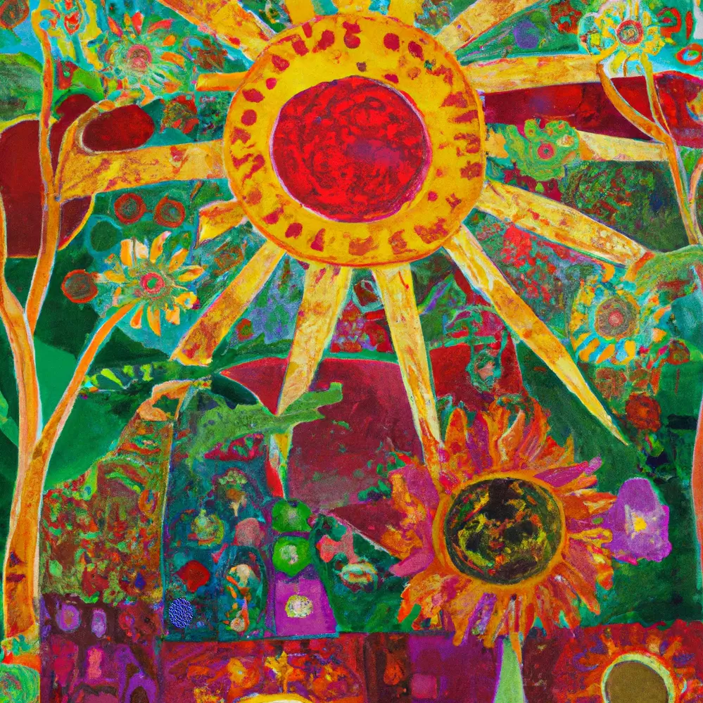</a>

**Inscription No.:** [**#1102985**](https://ordinals.com/inscription/2d4cff0bd6e6a2ff5526a50241034cd773e7fd39177aa63f2324d9a7b479ce93i0) · [Ordiscan](https://ordiscan.com/inscription/1102985)<br>
**ID:** `2d4cff0bd6e6a2ff5526a50241034cd773e7fd39177aa63f2324d9a7b479ce93i0`

> *A dazzling farewell. The setting evening sun cleaves the pictorial space in scarlet majesty before descending into total abstraction.*

**Atum-Ra.** PURKINJE IV culminates the twilight cycle in a magnificent, blinding oversaturation. We behold a radiant entity whose rigid beams of incandescent yellow drive inexorably into a dense, magenta underworld. The colours burn with an almost piercing beauty: the final, majestic surge of form before night and total abstraction descend. The work captures that fleeting, sublime threshold of day’s end — a jubilant valediction, a passage into the Duat steeped in purple and gold, awakening the eternal cadence of dissolution and renewal. A creation of uncompromising, sovereign magnificence leaving a profoundly cathartic resonance.

<br clear="both" />


---

<div align="center">

### CYCLE V — SPHERES OF BEING
*Echoes of the ancient and the unseen. The spheres in which existence reveals itself.*

</div>

#### SPHERES OF BEING I · *Ruty*

<a href="https://ordinals.com/inscription/48f3ac2993ff7b99af8bd054daef98cb26ef6e4ee0fb9be3fa6dce45aff4259di0"></a>

**Inscription No.:** [**#645229**](https://ordinals.com/inscription/48f3ac2993ff7b99af8bd054daef98cb26ef6e4ee0fb9be3fa6dce45aff4259di0) · [Ordiscan](https://ordiscan.com/inscription/645229)<br>
**ID:** `48f3ac2993ff7b99af8bd054daef98cb26ef6e4ee0fb9be3fa6dce45aff4259di0`

> *Two scarlet horizon sentinels with piercing jade eyes. A masterful synthesis of ancient Egyptian mythology and serial Pop Art.*

**Ruty.** SPHERES OF BEING I captivates through near-hypnotic figuration: two seemingly identical scarlet sentinels with piercing, incandescent jade eyes confront the viewer. Their gaze bridges millennia to ancient Egypt — evoking *Ruty*, the sacred dual guardians of the horizon who guarded the celestial threshold between yesterday and tomorrow, standing sentinel over the very spheres of being. Only upon prolonged contemplation does the apparent symmetry reveal those subtle deviations and organic variances that breathe life into the composition. An emerald collar adorned with golden ciphers rests upon the breast like an ornate pharaonic pectoral. The planar composition unmistakably channels the graphic potency of Andy Warhol’s Pop Art, yet entirely eschews its mechanical detachment. Cultivating instead a tangible, archaic presence, the work achieves an astute visual dialogue, bestowing profound metaphysical gravitas upon the convergence of pop culture and ancient Egyptian cosmology.

<br clear="both" />

#### SPHERES OF BEING II · *Yūgen*

<a href="https://ordinals.com/inscription/5e983da21ba0a6662e5b7070c82dfdcc2c6224e92f85cdd2d6849bffa03989b5i0"></a>

**Inscription No.:** [**#916346**](https://ordinals.com/inscription/5e983da21ba0a6662e5b7070c82dfdcc2c6224e92f85cdd2d6849bffa03989b5i0) · [Ordiscan](https://ordiscan.com/inscription/916346)<br>
**ID:** `5e983da21ba0a6662e5b7070c82dfdcc2c6224e92f85cdd2d6849bffa03989b5i0`

> *A masterpiece of radical introversion. Sealed golden spheres reveal a hypnotic, timeless presence far removed from the exterior world.*

**Yūgen.** SPHERES OF BEING II stands as a masterwork of radical introversion. The portrait mesmerises through its uncompromising refusal of the outward gaze. Monumental golden spheres sealing the eyes direct the viewer’s contemplation entirely towards the Japanese aesthetic principle of *Yūgen* (幽玄) — the profound, ineffable mystery of hidden grace. While the left half of the visage remains in porcelain, aristocratic repose, a delicate cascade of scarlet blossoms and golden buds descends over the right eye: a poetic palimpsest where organic life intertwines with awakened consciousness. Renouncing conventional perspective, the planar composition attains an immutable, timeless gravity. The work reveals itself upon prolonged reflection as a serene sanctuary for truths that dwell only in concealment — untouched by external banality.

<br clear="both" />

#### SPHERES OF BEING III · *The Glade of Iriy*

<a href="https://ordinals.com/inscription/cceae84e9aea8c4cdafc9f84bbe149c0ae920c1e18dc476d0343e2733836348bi0">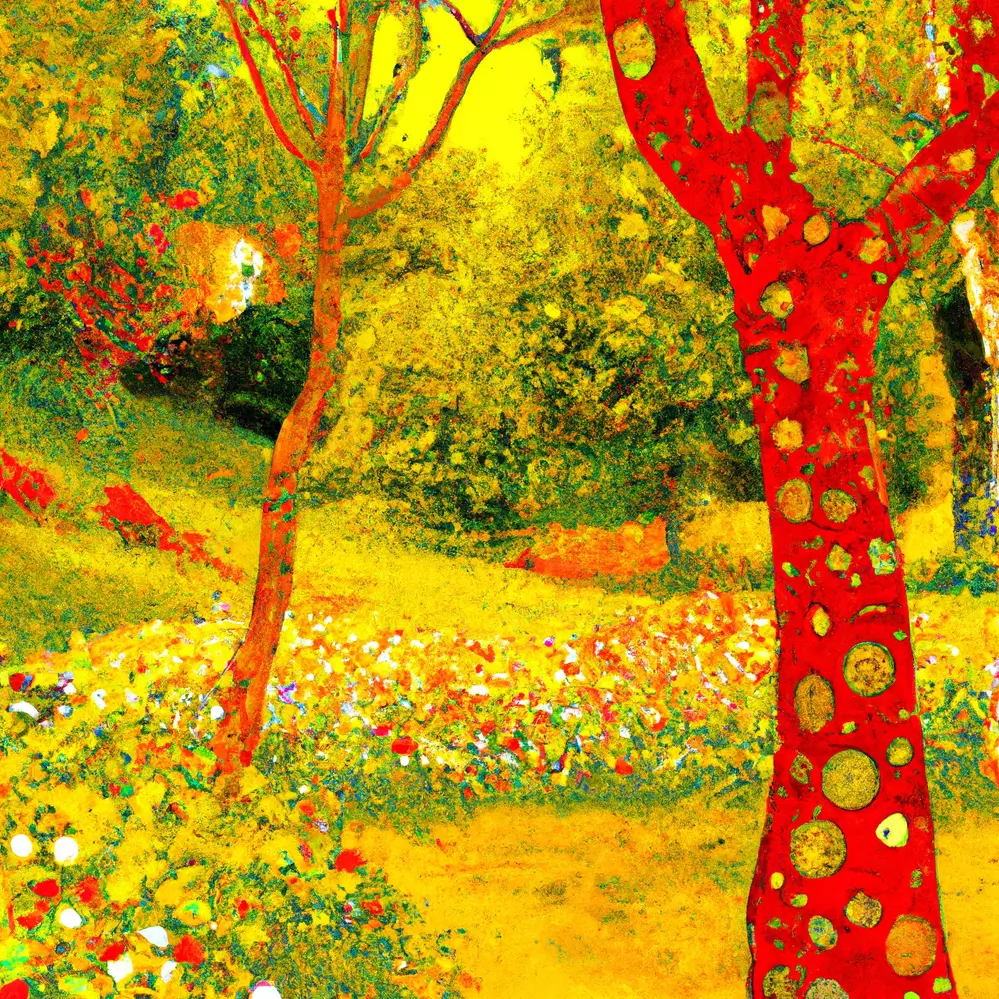</a>

**Inscription No.:** [**#485331**](https://ordinals.com/inscription/cceae84e9aea8c4cdafc9f84bbe149c0ae920c1e18dc476d0343e2733836348bi0) · [Ordiscan](https://ordiscan.com/inscription/485331)<br>
**ID:** `cceae84e9aea8c4cdafc9f84bbe149c0ae920c1e18dc476d0343e2733836348bi0`

> *A visual eruption at the threshold of the visible. Nature is liberated from organic constraints and elevated into alchemical ecstasy.*

**The Glade of Iriy.** SPHERES OF BEING III unfolds an alchemical intensity, emancipating nature from organic constraints into a state of pristine, energetic ecstasy. The incandescent yellow clearing evokes *Iriy* — the mythical Slavic realm of the afterlife, an eternal paradise forged entirely of uncreated light and transmuted matter. The solitary tree dominating the foreground breaks decisively with conventional landscape painting: its trunk, cloaked in pulsating poppy-red and studded with golden ornaments, radiates as a living, primordial force. It is the light of being itself illuminating form from within. Demonstrating masterful command over complementary chromatic density, the artefact channels the raw, visionary power of early Expressionism.

<br clear="both" />

#### SPHERES OF BEING IV · *Inti’s Sovereign*

<a href="https://ordinals.com/inscription/7bb89596bdc220facce5ba5874fbc5f380b9b063d9c80b93dcf704a3cd356b24i0">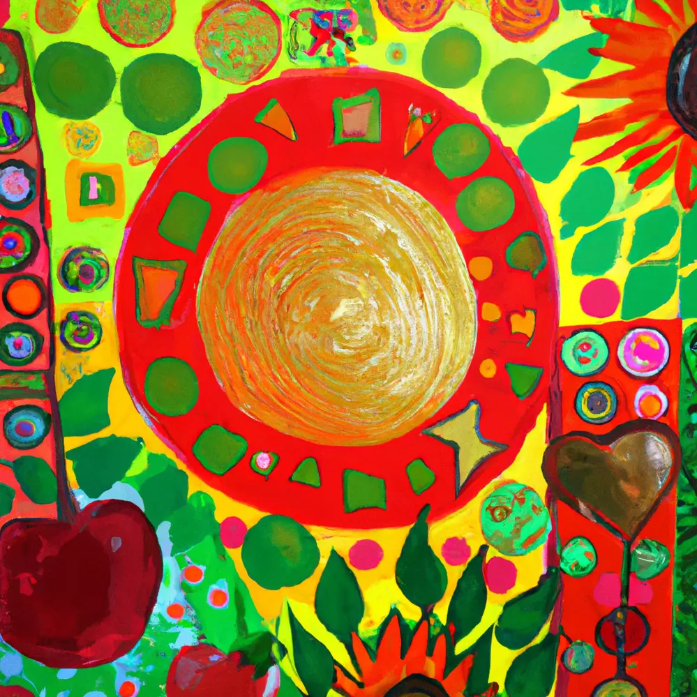</a>

**Inscription No.:** [**#459921**](https://ordinals.com/inscription/7bb89596bdc220facce5ba5874fbc5f380b9b063d9c80b93dcf704a3cd356b24i0) · [Ordiscan](https://ordiscan.com/inscription/459921)<br>
**ID:** `7bb89596bdc220facce5ba5874fbc5f380b9b063d9c80b93dcf704a3cd356b24i0`

> *An unburdened triumph of light. A sphere pulsating in gold and orange, framed by naive symbolism, concludes the cycle in joyful ecstasy.*

**Inti’s Sovereign.** SPHERES OF BEING IV concludes the cycle with an exuberant, chromatic eruption. Enthroned at the centre, a pulsating sphere of gold and orange pays vibrant homage to the imperial sovereignty of the pre-Columbian sun god Inti. The composition disavows all academic melancholy: isolating the solar core, it envelops it in a kinetic constellation of floral fragments, radiant hearts, and ripe cherries. The work oscillates masterfully between the serial reduction of Pop Art and the unfiltered innocence of Naive Art. The dense, revolving architecture of the central sphere exerts a gentle, hypnotic pull. Entering this space, one encounters art in its most pristine register — as an absolute, unburdened triumph of light leaving an enduring, luminous resonance.

<br clear="both" />


---

<div align="center">

### CYCLE VI — SINGULARITY
*The point beyond which all known laws cease.*

</div>

#### SINGULARITY I · *Primordial Plasma*

<a href="https://ordinals.com/inscription/3bbce82b720b3fcc5f59e998061f702d64eb0cdcd10710dd2e22e1155bd1f8cfi0">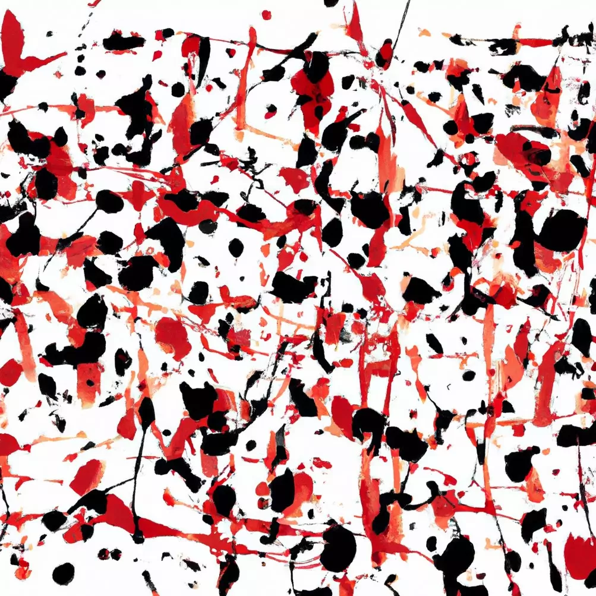</a>

**Inscription No.:** [**#916988**](https://ordinals.com/inscription/3bbce82b720b3fcc5f59e998061f702d64eb0cdcd10710dd2e22e1155bd1f8cfi0) · [Ordiscan](https://ordiscan.com/inscription/916988)<br>
**ID:** `3bbce82b720b3fcc5f59e998061f702d64eb0cdcd10710dd2e22e1155bd1f8cfi0`

> *The genesis of space. A furious action painting on a radiant white ground stages the eruptive freedom of being within the infinite vacuum.*

**Primordial Plasma.** SINGULARITY I marks the definitive threshold into the cycle, isolating the high-energy state immediately following the Big Bang. The masterwork breathes the boundless freedom of an unimpeded cosmos: upon a radiant white ground unfolds a furious, untamed action painting whose scarlet and pitch-black pigments exist in maximum expansion. The creation deliberately shatters formal control, citing the physical unleashing of Jackson Pollock and his drip paintings. There is not yet gravity, no centring, no system — only the eruptive freedom of existence within the infinite vacuum. The overwhelming kinetic force is chaotic, yet sustained in immaculate internal coherence. Within the architecture of the manifesto, this Inscription embodies the moment of radical decentralisation: the raw rupture of energy before the inexorable protocol of subsequent stages channels forms into compelling trajectories. At this threshold, art exists in its most inviolate state as pure, immaterial noise before order — an enduring resonance of digital sovereignty.

<br clear="both" />

#### SINGULARITY II · *Primordial Voids*

<a href="https://ordinals.com/inscription/63f0b78e35bcb0d8345f7ce48dfd08ecc4d27c18ca0ff0fe4bbc8bb243cc570bi0">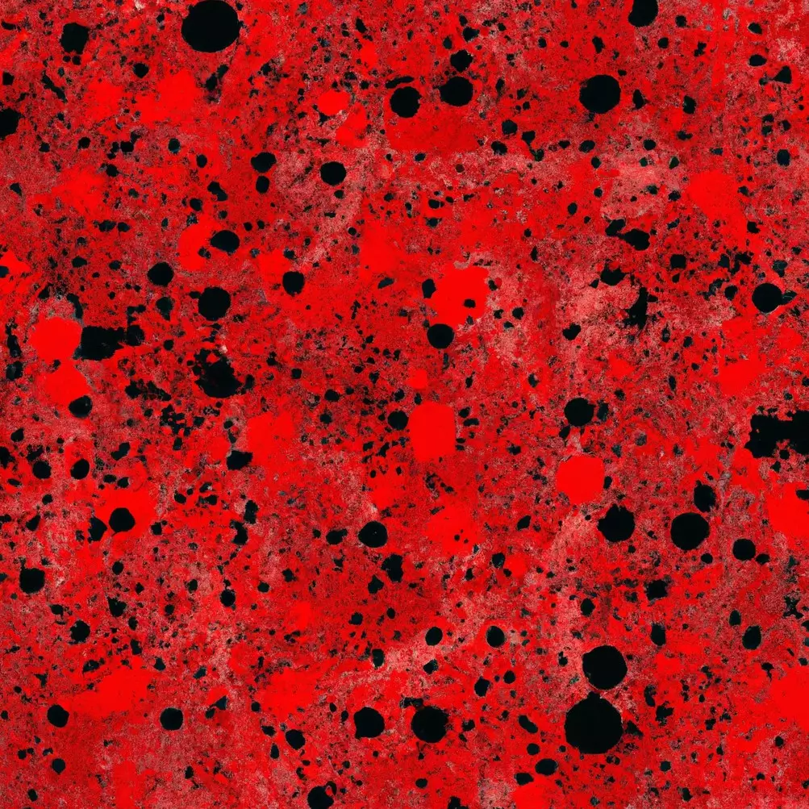</a>

**Inscription No.:** [**#927939**](https://ordinals.com/inscription/63f0b78e35bcb0d8345f7ce48dfd08ecc4d27c18ca0ff0fe4bbc8bb243cc570bi0) · [Ordiscan](https://ordiscan.com/inscription/927939)<br>
**ID:** `63f0b78e35bcb0d8345f7ce48dfd08ecc4d27c18ca0ff0fe4bbc8bb243cc570bi0`

> *The threshold of total collapse. Thermodynamic voids perforate an incandescent cosmic fabric under colossal gravitational load.*

**Primordial Voids.** SINGULARITY II isolates the large-scale architecture of the early universe through the compression of the macrocosm. The Inscription chronicles the instant the cosmic fabric itself implodes under colossal gravitational load. The incandescent red embodies the thermonuclear glow of entire galactic clusters and primordial matter streams forced into ultimate compaction. This vast, burning field is perforated by countless pitch-black voids: immense megastructures of nothingness spanning light-years, gnawing through space-time. These are not flaws in the composition, but the true architects of new being — thermodynamic voids of unimaginable expanse drawing surrounding energy into a hypnotic vortex. The composition refuses decorative ease. Within the cycle, this work represents the immediate threshold of total macrocosmic collapse — the incorruptible protocol preparing the ultimate transmutation of all known space.

<br clear="both" />

#### SINGULARITY III · *The Cosmic Ballet*

<a href="https://ordinals.com/inscription/93d1b7da0701a5f0555702bddc9031e3bc959853db31768cdc5b8b0bbfff0fc7i0">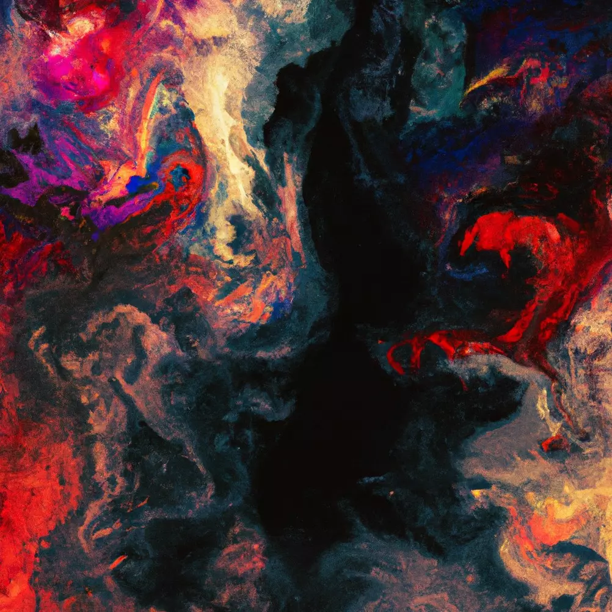</a>

**Inscription No.:** [**#1038647**](https://ordinals.com/inscription/93d1b7da0701a5f0555702bddc9031e3bc959853db31768cdc5b8b0bbfff0fc7i0) · [Ordiscan](https://ordiscan.com/inscription/1038647)<br>
**ID:** `93d1b7da0701a5f0555702bddc9031e3bc959853db31768cdc5b8b0bbfff0fc7i0`

> *A dance at the brink of the event horizon. Collapsing matter choreographs a cyclical, melancholic ballet of cosmic hues.*

**The Cosmic Ballet.** SINGULARITY III channels the gravitational implosion of its predecessor into a final, majestic rotation, embodying the irrevocable centralisation of space. The artwork reveals the depths of galactic darkness: a vast cloud of matter commanded by deep violet, magenta, and Prussian blue begins to orbit inexorably around a massive, pitch-black core. The composition transforms the static glow of cosmic voids into a cyclical, near-ritual motion. Pigment is no longer eruptively hurled, but poured in fluid currents, swirling weightless and melancholic through the digital aether. Pigments are bound by the gravitational centre into elliptical trajectories — a dance at the precipice of the event horizon balancing Baroque opulence with cosmic austerity. The flares of colour evoke the dying luminescence of stars before they are consumed by the informational density of the singularity: the immutable law of the protocol imposing its final, incorruptible choreography upon the cosmos.

<br clear="both" />

#### SINGULARITY IV · *Currents of Gold*

<a href="https://ordinals.com/inscription/077bafc1d3398db1b555ce12961d622c2c2fbd9ab4fff8cfa98843c1ef7b29e5i0"></a>

**Inscription No.:** [**#1038653**](https://ordinals.com/inscription/077bafc1d3398db1b555ce12961d622c2c2fbd9ab4fff8cfa98843c1ef7b29e5i0) · [Ordiscan](https://ordiscan.com/inscription/1038653)<br>
**ID:** `077bafc1d3398db1b555ce12961d622c2c2fbd9ab4fff8cfa98843c1ef7b29e5i0`

> *The genesis of value. In the stellar crucibles of the cosmos, chaotic matter coalesces under immense pressure into majestic currents of gold.*

**Currents of Gold.** SINGULARITY IV celebrates luxurious dissolution: the genesis of value and the crowning finale of the cosmic chronology. Following primordial expansion, the birth of vast voids, and the orbital choreography of early galaxies, the moment of elemental nucleosynthesis arrives. Under unimaginable cosmic pressure within the crucibles of the universe, the heaviest, most noble elements condense — chief among them the quintessential substance of art: gold. The pictorial field transforms into a viscous, majestic flux of deep ochre, obsidian magma, and cascading golden currents. The scarlet embers of genesis are displaced to the periphery, having surrendered their energy to forge enduring substance and immutable value. Channelling the dense gravitas of mature *Art Informel*, this Inscription stands for the definitive triumph of order over entropy: a monument to the emergence of beauty, permanent value, and the incorruptible truth of a consummated protocol.

<br clear="both" />


---

<div align="center">

### CYCLE VII — MAGNUM OPUS
*Peace as the ultimate masterpiece. The only soil in which art can breathe.*

</div>

#### MAGNUM OPUS I · *Alpine Solitude*

<a href="https://ordinals.com/inscription/afe92ac3e7e99b0dbfb7e2781614a0e856dbd7023c1ffaa39d69582e92c33cf0i0">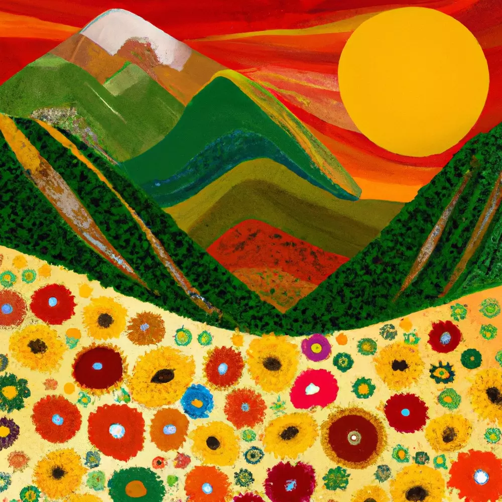</a>

**Inscription No.:** [**#1188605**](https://ordinals.com/inscription/afe92ac3e7e99b0dbfb7e2781614a0e856dbd7023c1ffaa39d69582e92c33cf0i0) · [Ordiscan](https://ordiscan.com/inscription/1188605)<br>
**ID:** `afe92ac3e7e99b0dbfb7e2781614a0e856dbd7023c1ffaa39d69582e92c33cf0i0`

> *Retreat into untouched topography. Alpine Solitude establishes natural isolation as the primary, instinctive sanctuary of the intellect.*

**Alpine Solitude.** The artefact erupts in near-Fauvist chromatic intensity: a burning, poppy-red sky bears a colossal planar sun of brilliant yellow, while the middle ground is commanded by the archaic tectonic layering of alpine ranges. The Inscription breathes the solemn cadence of Ferdinand Hodler’s Parallelism, dissolving in the foreground into a vibrant floral carpet citing the ornamental opulence of Gustav Klimt’s landscapes. The conceptual core of this overture lies in deliberate withdrawal from human turmoil. Alpine Solitude is no decorative pastoral, but a radical topographical sanctuary. To reclaim contemplation, inner equilibrium, and the perception of beauty, the spirit seeks refuge from civilisational exhaustion in the pristine solitude of the high peaks. It embodies a defensive peace forged through total isolation — a grounding in unyielding nature that establishes the indestructible foundation for the deeper evolution of consciousness.

<br clear="both" />

#### MAGNUM OPUS II · *The Shield of Care*

<a href="https://ordinals.com/inscription/e7c3deb809eb5ac51bad66e50599154aa52eca0dd764e7736db0813f41987573i0">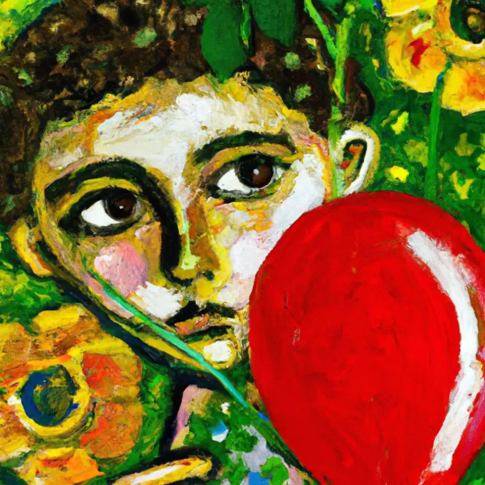</a>

**Inscription No.:** [**#919079**](https://ordinals.com/inscription/e7c3deb809eb5ac51bad66e50599154aa52eca0dd764e7736db0813f41987573i0) · [Ordiscan](https://ordiscan.com/inscription/919079)<br>
**ID:** `e7c3deb809eb5ac51bad66e50599154aa52eca0dd764e7736db0813f41987573i0`

> *The radiance of primal trust in the modern gaze. As the scarlet sphere becomes a shield of care, the soul celebrates unconditional sanctuary.*

**The Shield of Care.** Within the collection, this work marks a momentous threshold into the warming mystery of the human soul — the instant the cosmos begins to feel. The Inscription breathes the wistful tenderness of Amedeo Modigliani: the child’s oversized, almond eyes bear the ancient melancholy of awakening existence — mask-like, vulnerable, and imbued with timeless depth. Yet the composition leaves this visage not in solitude; it cradles the spirit within a protective lullaby of soft, haptic floral dreams. Hovering above, echoing a maternal heartbeat, a monumental scarlet sphere presides: a cosmic shield translating primal trust (*Urvertrauen*) into visual form. Here, the work celebrates the quiet miracle of parental care — that evolutionary milestone where the nurturing instinct vanquished primordial brutality. It charts that biochemical poetry wherein oxytocin dissolves existential dread, enfolding the young in unconditional sanctuary. A monument to the silencing of fear, enabling the human spirit to behold the beauty of the world.

<br clear="both" />

#### MAGNUM OPUS III · *The Crescent of Isfahan*

<a href="https://ordinals.com/inscription/bb0cb5cf35235212fdfb442df34200ddf8c8311d360765400a88a5ecec89f76bi0">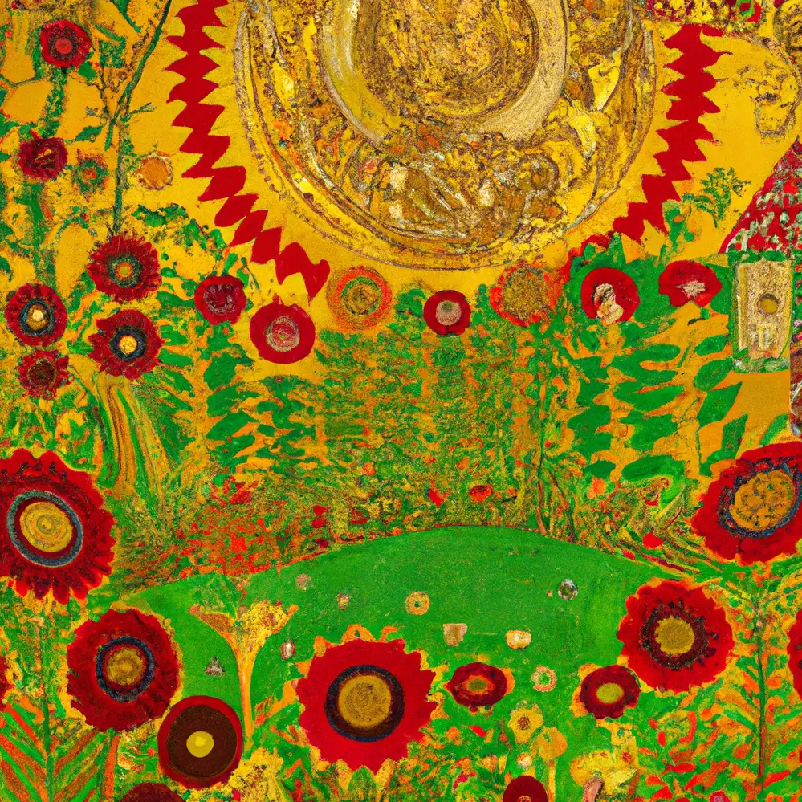</a>

**Inscription No.:** [**#661591**](https://ordinals.com/inscription/bb0cb5cf35235212fdfb442df34200ddf8c8311d360765400a88a5ecec89f76bi0) · [Ordiscan](https://ordiscan.com/inscription/661591)<br>
**ID:** `bb0cb5cf35235212fdfb442df34200ddf8c8311d360765400a88a5ecec89f76bi0`

> *When Klimt’s gold meets the geometry of Isfahan, the searching spirit finds its profoundest peace in the moment of consummate form.*

**The Crescent of Isfahan.** This Inscription enters the sacred sanctuary of the creative spirit. MAGNUM OPUS III marks a magical turning point: the unshakeable peace experienced by the artist in the instant of pure inspiration, transcending space and time. As worldly chaos falls silent, vision awakens to sovereign creativity. The work establishes a breathtaking transcultural bridge across centuries: fusing the golden, Ravenna-inspired mosaic opulence of Gustav Klimt with the infinite planar ornamentation of Persian art in the tradition of Reza Abbasi. The pictorial field transforms into a transcendent cosmos of shimmering gold, delicate floral arabesques, and mathematical rhythm. Every pixel, every digital tessera appears set in a state of absolute, meditative absorption beneath midday heat: the visual distillation of a creative trance where time halts and the soul finds consummate fulfilment in the act of shaping form. The work celebrates inner peace as high-energy focus wherein beauty is born from divine order — a luminous monument to inspiration.

<br clear="both" />

#### MAGNUM OPUS IV · *Pax*

<a href="https://ordinals.com/inscription/a88138337461462ede84e8799e8a6c27e13b88a706ca2789b15a4efe064a8aa9i0"></a>

**Inscription No.:** [**#878104**](https://ordinals.com/inscription/a88138337461462ede84e8799e8a6c27e13b88a706ca2789b15a4efe064a8aa9i0) · [Ordiscan](https://ordiscan.com/inscription/878104)<br>
**ID:** `a88138337461462ede84e8799e8a6c27e13b88a706ca2789b15a4efe064a8aa9i0`

> *The fading of the storm in eternal radiance. As civilisation’s soul finds its safe haven, stillness becomes the guardian patron of beauty.*

**Pax.** With Pax, a luminous, atmospheric infinity opens. The Inscription bows in profound reverence before the genius of J.M.W. Turner, who revolutionised European painting by dissolving solid matter to render light itself tangible. A majestic vessel glides across mirror-smooth waters shimmering in burnished gold, buoyed by a gently waning day whose sunset cloaks the horizon in consoling radiance. It presents the eternal, poignant archetype of homecoming: the moment sails descend and motion yields to reverent repose. Yet this haven is far more than a maritime idyll; it stands as a potent metaphor for civilisational peace. Art, like the vessel, is a fragile marvel — a shy phenomenon requiring the sanctuary of stillness to be born and the protective mantle of peace to endure for eternity. Pax is an algorithmic testament that all creative endeavour is futile if we lose the civil space for its preservation: the silent, immortal covenant of a society resolving to pause, safeguard its treasures from oblivion, and offer beauty a permanent home.

<br clear="both" />


---

<div align="center">

### CYCLE VIII — YOUTH
*The poignant epilogue. Poetry, dream, and the eternal promise of beginnings.*

</div>

#### YOUTH I · *The Scarlet Steed*

<a href="https://ordinals.com/inscription/3206f06451a52fdddacdf23ed5101afceb54affc39748363b0dba4c1d3174374i0"></a>

**Inscription No.:** [**#484687**](https://ordinals.com/inscription/3206f06451a52fdddacdf23ed5101afceb54affc39748363b0dba4c1d3174374i0) · [Ordiscan](https://ordiscan.com/inscription/484687)<br>
**ID:** `3206f06451a52fdddacdf23ed5101afceb54affc39748363b0dba4c1d3174374i0`

> *As the scarlet steed breaks through burning fields of possibility, youth crowns the world as its singular truth.*

**The Scarlet Steed.** This creation disavows all measured restraint: an uncompromising, flaming homage to the legacy of German Expressionism and the visionary chromatic philosophy of Franz Marc. Here, colour is liberated from any obligation to mimic physical reality, becoming an untamed emotional state. A majestic, cadmium-red steed commands the pictorial plane in dynamic tension, framed by a shimmering terrain of radiant chrome yellow and tectonic hills of pure cobalt and ultramarine. The work is an Expressionist celebration: youth questions not the destination — it is pure velocity. The muscular, elongated contours of the horse vibrate with kinetic vitality, poised to transcend the terrain of mere reason. There is no protective frame and no compromise — only the unconditional forward surge of the spirit in its wildest phase. The Scarlet Steed charts the instant life tears away the reins to spend itself freely: a triumphant monument of rebirth opening human perception to the untamed electricity of existence.

<br clear="both" />

#### YOUTH II · *The Noble Cavalier*

<a href="https://ordinals.com/inscription/4c469ec788473f83636feb90ba372e087b88fced82fe6b0086ac9c89f4c99cd7i0"></a>

**Inscription No.:** [**#490527**](https://ordinals.com/inscription/4c469ec788473f83636feb90ba372e087b88fced82fe6b0086ac9c89f4c99cd7i0) · [Ordiscan](https://ordiscan.com/inscription/490527)<br>
**ID:** `4c469ec788473f83636feb90ba372e087b88fced82fe6b0086ac9c89f4c99cd7i0`

> *When youthful grace meets the spark of encounter, the racing heart becomes an unforgettable monument to youth.*

**The Noble Cavalier.** The portrait immerses itself in dreamlike, near-Chagallian poetry, transmuting raw vitality into the delicate elegance of the soul. Through the fragmented, Cubist digital linearity of the youth, The Noble Cavalier radiates a poignant, almost hesitant dignity. With a gesture of reverent devotion, the red hand rests upon the breast — the painterly equivalent of a racing, joyful heart holding its breath before the beloved. The work isolates the instant of unshakeable primal trust in the other. While the background rests in deep, protective Chartres blue and cobalt, the right flank erupts in an orchestral floral cosmos of warm yellow, orange, and scarlet. Here, facets of Pablo Picasso’s early Cubist portraiture merge with the emotive chromatic power of Fauvism. A visual manifestation of that first enchanted rendezvous etched indelibly into emotional memory, glorifying youth’s courage to surrender to love without armour.

<br clear="both" />

#### YOUTH III · *The Innocent Heir*

<a href="https://ordinals.com/inscription/e81b96dd99dcea84b2d9b2e0c27d04047e996ffa17151040b1793ea595517fedi0"></a>

**Inscription No.:** [**#928809**](https://ordinals.com/inscription/e81b96dd99dcea84b2d9b2e0c27d04047e996ffa17151040b1793ea595517fedi0) · [Ordiscan](https://ordiscan.com/inscription/928809)<br>
**ID:** `e81b96dd99dcea84b2d9b2e0c27d04047e996ffa17151040b1793ea595517fedi0`

> *Ascension to the throne. As time embraces the uncensored inheritance of the world, the future transforms into majestic reality.*

**The Innocent Heir.** An unconditional assault upon the fullness of life. This triptych fragment sweeps away all lingering reserve, glorifying youth as the rightful, sovereign heir to human civilisation. The work rejects any reductive material reading: this inheritance is not a burden, but an ecstatic coronation. Visually, the Inscription erupts in untamed poetic spontaneity in deep spiritual kinship with the cosmology of Joan Miró: his signature heavy black contours, the unfiltered brilliance of primary colours, and stellar floral ciphers emerging from deep ultramarine like heraldic emblems of a new era. The colossal, wide eyes of the heir gaze without fear or cynicism, radiant with that radical clarity sought by the avant-garde across lifetimes. Hands reach forward, simultaneously protective and possessive, ready to enfold the totality of existence: the immaculate beauty of art, the unyielding precision of technology, the gathered wisdom of epochs — alongside the scars and unresolved chaos of the Old World. The Innocent Heir stands as the ultimate monument to radical life-affirmation, charting that transcendent instant when consciousness resolves not to judge or fear the world, but to become it entirely.

<br clear="both" />

---

## CYCLE GALLERY — XXXI

The following visual matrix indexes all 31 masterpieces of *The Beautinals* collection alongside their canonical Inscription numbers, fully and natively verifiable upon the Bitcoin blockchain.

### CYCLE I: EIDOS

| [](https://ordinals.com/inscription/dbe22d7b82463648a5fa1f2d8ae14ab697ac752905dbaba3a88239cd22838e83i0) | [](https://ordinals.com/inscription/2baf3e3a5964319ad1e214c72e7a29657b981ec0466ce863a1de0a9d5525df4ei0) | [](https://ordinals.com/inscription/6e4c549d4058efaf3aba86f9f67442a46d9eb9937d22ec5a9038daa53859e3d7i0) | [](https://ordinals.com/inscription/e186cd412e24ff565dcec93da6e90afa2471aa14c20d915220b3b2d34e9272dbi0) |
| :---: | :---: | :---: | :---: |
| **EIDOS I**<br>[**#481817**](https://ordinals.com/inscription/dbe22d7b82463648a5fa1f2d8ae14ab697ac752905dbaba3a88239cd22838e83i0) | **EIDOS II**<br>[**#504407**](https://ordinals.com/inscription/2baf3e3a5964319ad1e214c72e7a29657b981ec0466ce863a1de0a9d5525df4ei0) | **EIDOS III**<br>[**#507915**](https://ordinals.com/inscription/6e4c549d4058efaf3aba86f9f67442a46d9eb9937d22ec5a9038daa53859e3d7i0) | **EIDOS IV**<br>[**#917920**](https://ordinals.com/inscription/e186cd412e24ff565dcec93da6e90afa2471aa14c20d915220b3b2d34e9272dbi0) |

### CYCLE II: GEOSMIN

| [](https://ordinals.com/inscription/9d6c6332e665e532d04aa655322122cbb5ea90c6ed2a95677d271af9aeea9c3bi0) | [](https://ordinals.com/inscription/c7016c2559fb59ac9ab0c057e644d058e7b93a3fe4af44eda7f9daa60eb6dd7di0) | [](https://ordinals.com/inscription/2f9c7ed1e0e650b42360e38d18bda2fbc1f21e230cf11cba4628d58a2fe98b26i0) | [](https://ordinals.com/inscription/c1f2ab63acbee9b74a42561c05d6d867052ebe956ede4ff332c53ab2c873812ci0) |
| :---: | :---: | :---: | :---: |
| **GEOSMIN I**<br>[**#929807**](https://ordinals.com/inscription/9d6c6332e665e532d04aa655322122cbb5ea90c6ed2a95677d271af9aeea9c3bi0) | **GEOSMIN II**<br>[**#916020**](https://ordinals.com/inscription/c7016c2559fb59ac9ab0c057e644d058e7b93a3fe4af44eda7f9daa60eb6dd7di0) | **GEOSMIN III**<br>[**#756309**](https://ordinals.com/inscription/2f9c7ed1e0e650b42360e38d18bda2fbc1f21e230cf11cba4628d58a2fe98b26i0) | **GEOSMIN IV**<br>[**#756311**](https://ordinals.com/inscription/c1f2ab63acbee9b74a42561c05d6d867052ebe956ede4ff332c53ab2c873812ci0) |

### CYCLE III: HORTUS

| [](https://ordinals.com/inscription/a76326cbf065df883be3e54ad2d1f996a1d87bbd3b4fa6c5a9f5d04f961a9d56i0) | [](https://ordinals.com/inscription/5e50408dff42426da662ffc1a7cdc610a4d0e550cf715bf927a21715e879d015i0) | [](https://ordinals.com/inscription/7dde7c13da15e2eb89da1cfd7abef6a74238ba50b53498f5250852766e34e5f0i0) | [](https://ordinals.com/inscription/405d3b13f066e90efc5ee87c6bdb285ef129b8fa2b76967563a5da13b971fffci0) |
| :---: | :---: | :---: | :---: |
| **HORTUS I**<br>[**#661407**](https://ordinals.com/inscription/a76326cbf065df883be3e54ad2d1f996a1d87bbd3b4fa6c5a9f5d04f961a9d56i0) | **HORTUS II**<br>[**#660455**](https://ordinals.com/inscription/5e50408dff42426da662ffc1a7cdc610a4d0e550cf715bf927a21715e879d015i0) | **HORTUS III**<br>[**#928810**](https://ordinals.com/inscription/7dde7c13da15e2eb89da1cfd7abef6a74238ba50b53498f5250852766e34e5f0i0) | **HORTUS IV**<br>[**#928811**](https://ordinals.com/inscription/405d3b13f066e90efc5ee87c6bdb285ef129b8fa2b76967563a5da13b971fffci0) |

### CYCLE IV: PURKINJE

| [](https://ordinals.com/inscription/a6b012fdbd5b0c75507fce25d828d8bded78808384b334a64265c28e49f87303i0) | [](https://ordinals.com/inscription/08bac3932271c20793775fa437563a34f6cf218226f2e7dd331781ea20a23208i0) | [](https://ordinals.com/inscription/6bbd9c22c2bf43fb6c246ad146445b677a3ae14ff0ec486ac1c75b6fc31ba3f3i0) | [](https://ordinals.com/inscription/2d4cff0bd6e6a2ff5526a50241034cd773e7fd39177aa63f2324d9a7b479ce93i0) |
| :---: | :---: | :---: | :---: |
| **PURKINJE I**<br>[**#1080448**](https://ordinals.com/inscription/a6b012fdbd5b0c75507fce25d828d8bded78808384b334a64265c28e49f87303i0) | **PURKINJE II**<br>[**#1080504**](https://ordinals.com/inscription/08bac3932271c20793775fa437563a34f6cf218226f2e7dd331781ea20a23208i0) | **PURKINJE III**<br>[**#1107899**](https://ordinals.com/inscription/6bbd9c22c2bf43fb6c246ad146445b677a3ae14ff0ec486ac1c75b6fc31ba3f3i0) | **PURKINJE IV**<br>[**#1102985**](https://ordinals.com/inscription/2d4cff0bd6e6a2ff5526a50241034cd773e7fd39177aa63f2324d9a7b479ce93i0) |

### CYCLE V: SPHERES OF BEING

| [](https://ordinals.com/inscription/48f3ac2993ff7b99af8bd054daef98cb26ef6e4ee0fb9be3fa6dce45aff4259di0) | [](https://ordinals.com/inscription/5e983da21ba0a6662e5b7070c82dfdcc2c6224e92f85cdd2d6849bffa03989b5i0) | [](https://ordinals.com/inscription/cceae84e9aea8c4cdafc9f84bbe149c0ae920c1e18dc476d0343e2733836348bi0) | [](https://ordinals.com/inscription/7bb89596bdc220facce5ba5874fbc5f380b9b063d9c80b93dcf704a3cd356b24i0) |
| :---: | :---: | :---: | :---: |
| **SPHERES OF BEING I**<br>[**#645229**](https://ordinals.com/inscription/48f3ac2993ff7b99af8bd054daef98cb26ef6e4ee0fb9be3fa6dce45aff4259di0) | **SPHERES OF BEING II**<br>[**#916346**](https://ordinals.com/inscription/5e983da21ba0a6662e5b7070c82dfdcc2c6224e92f85cdd2d6849bffa03989b5i0) | **SPHERES OF BEING III**<br>[**#485331**](https://ordinals.com/inscription/cceae84e9aea8c4cdafc9f84bbe149c0ae920c1e18dc476d0343e2733836348bi0) | **SPHERES OF BEING IV**<br>[**#459921**](https://ordinals.com/inscription/7bb89596bdc220facce5ba5874fbc5f380b9b063d9c80b93dcf704a3cd356b24i0) |

### CYCLE VI: SINGULARITY

| [](https://ordinals.com/inscription/3bbce82b720b3fcc5f59e998061f702d64eb0cdcd10710dd2e22e1155bd1f8cfi0) | [](https://ordinals.com/inscription/63f0b78e35bcb0d8345f7ce48dfd08ecc4d27c18ca0ff0fe4bbc8bb243cc570bi0) | [](https://ordinals.com/inscription/93d1b7da0701a5f0555702bddc9031e3bc959853db31768cdc5b8b0bbfff0fc7i0) | [](https://ordinals.com/inscription/077bafc1d3398db1b555ce12961d622c2c2fbd9ab4fff8cfa98843c1ef7b29e5i0) |
| :---: | :---: | :---: | :---: |
| **SINGULARITY I**<br>[**#916988**](https://ordinals.com/inscription/3bbce82b720b3fcc5f59e998061f702d64eb0cdcd10710dd2e22e1155bd1f8cfi0) | **SINGULARITY II**<br>[**#927939**](https://ordinals.com/inscription/63f0b78e35bcb0d8345f7ce48dfd08ecc4d27c18ca0ff0fe4bbc8bb243cc570bi0) | **SINGULARITY III**<br>[**#1038647**](https://ordinals.com/inscription/93d1b7da0701a5f0555702bddc9031e3bc959853db31768cdc5b8b0bbfff0fc7i0) | **SINGULARITY IV**<br>[**#1038653**](https://ordinals.com/inscription/077bafc1d3398db1b555ce12961d622c2c2fbd9ab4fff8cfa98843c1ef7b29e5i0) |

### CYCLE VII: MAGNUM OPUS

| [](https://ordinals.com/inscription/afe92ac3e7e99b0dbfb7e2781614a0e856dbd7023c1ffaa39d69582e92c33cf0i0) | [](https://ordinals.com/inscription/e7c3deb809eb5ac51bad66e50599154aa52eca0dd764e7736db0813f41987573i0) | [](https://ordinals.com/inscription/bb0cb5cf35235212fdfb442df34200ddf8c8311d360765400a88a5ecec89f76bi0) | [](https://ordinals.com/inscription/a88138337461462ede84e8799e8a6c27e13b88a706ca2789b15a4efe064a8aa9i0) |
| :---: | :---: | :---: | :---: |
| **MAGNUM OPUS I**<br>[**#1188605**](https://ordinals.com/inscription/afe92ac3e7e99b0dbfb7e2781614a0e856dbd7023c1ffaa39d69582e92c33cf0i0) | **MAGNUM OPUS II**<br>[**#919079**](https://ordinals.com/inscription/e7c3deb809eb5ac51bad66e50599154aa52eca0dd764e7736db0813f41987573i0) | **MAGNUM OPUS III**<br>[**#661591**](https://ordinals.com/inscription/bb0cb5cf35235212fdfb442df34200ddf8c8311d360765400a88a5ecec89f76bi0) | **MAGNUM OPUS IV**<br>[**#878104**](https://ordinals.com/inscription/a88138337461462ede84e8799e8a6c27e13b88a706ca2789b15a4efe064a8aa9i0) |

### CYCLE VIII: YOUTH

| [](https://ordinals.com/inscription/3206f06451a52fdddacdf23ed5101afceb54affc39748363b0dba4c1d3174374i0) | [](https://ordinals.com/inscription/4c469ec788473f83636feb90ba372e087b88fced82fe6b0086ac9c89f4c99cd7i0) | [](https://ordinals.com/inscription/e81b96dd99dcea84b2d9b2e0c27d04047e996ffa17151040b1793ea595517fedi0) |
| :---: | :---: | :---: |
| **YOUTH I**<br>[**#484687**](https://ordinals.com/inscription/3206f06451a52fdddacdf23ed5101afceb54affc39748363b0dba4c1d3174374i0) | **YOUTH II**<br>[**#490527**](https://ordinals.com/inscription/4c469ec788473f83636feb90ba372e087b88fced82fe6b0086ac9c89f4c99cd7i0) | **YOUTH III**<br>[**#928809**](https://ordinals.com/inscription/e81b96dd99dcea84b2d9b2e0c27d04047e996ffa17151040b1793ea595517fedi0) |

---

## CANONICAL REGISTRY TABLE — XXXI MASTERPIECES

| # | Cycle | Work Designation | Curatorial Title | Inscription No. | Inscription ID | On-Chain Verification |
| :---: | :--- | :--- | :--- | :---: | :--- | :---: |
| **1** | CYCLE I: EIDOS | **EIDOS I** | *The Golden Sovereign* | [**#481817**](https://ordinals.com/inscription/dbe22d7b82463648a5fa1f2d8ae14ab697ac752905dbaba3a88239cd22838e83i0) | `dbe22d7b82463648a5fa1f2d8ae14ab697ac752905dbaba3a88239cd22838e83i0` | [Ordinals](https://ordinals.com/inscription/dbe22d7b82463648a5fa1f2d8ae14ab697ac752905dbaba3a88239cd22838e83i0) · [Ordiscan](https://ordiscan.com/inscription/481817) |
| **2** | CYCLE I: EIDOS | **EIDOS II** | *The Phantom Visage* | [**#504407**](https://ordinals.com/inscription/2baf3e3a5964319ad1e214c72e7a29657b981ec0466ce863a1de0a9d5525df4ei0) | `2baf3e3a5964319ad1e214c72e7a29657b981ec0466ce863a1de0a9d5525df4ei0` | [Ordinals](https://ordinals.com/inscription/2baf3e3a5964319ad1e214c72e7a29657b981ec0466ce863a1de0a9d5525df4ei0) · [Ordiscan](https://ordiscan.com/inscription/504407) |
| **3** | CYCLE I: EIDOS | **EIDOS III** | *The Emerald Gaze* | [**#507915**](https://ordinals.com/inscription/6e4c549d4058efaf3aba86f9f67442a46d9eb9937d22ec5a9038daa53859e3d7i0) | `6e4c549d4058efaf3aba86f9f67442a46d9eb9937d22ec5a9038daa53859e3d7i0` | [Ordinals](https://ordinals.com/inscription/6e4c549d4058efaf3aba86f9f67442a46d9eb9937d22ec5a9038daa53859e3d7i0) · [Ordiscan](https://ordiscan.com/inscription/507915) |
| **4** | CYCLE I: EIDOS | **EIDOS IV** | *Crimson Awakening* | [**#917920**](https://ordinals.com/inscription/e186cd412e24ff565dcec93da6e90afa2471aa14c20d915220b3b2d34e9272dbi0) | `e186cd412e24ff565dcec93da6e90afa2471aa14c20d915220b3b2d34e9272dbi0` | [Ordinals](https://ordinals.com/inscription/e186cd412e24ff565dcec93da6e90afa2471aa14c20d915220b3b2d34e9272dbi0) · [Ordiscan](https://ordiscan.com/inscription/917920) |
| **5** | CYCLE II: GEOSMIN | **GEOSMIN I** | *Bloom of Gaia* | [**#929807**](https://ordinals.com/inscription/9d6c6332e665e532d04aa655322122cbb5ea90c6ed2a95677d271af9aeea9c3bi0) | `9d6c6332e665e532d04aa655322122cbb5ea90c6ed2a95677d271af9aeea9c3bi0` | [Ordinals](https://ordinals.com/inscription/9d6c6332e665e532d04aa655322122cbb5ea90c6ed2a95677d271af9aeea9c3bi0) · [Ordiscan](https://ordiscan.com/inscription/929807) |
| **6** | CYCLE II: GEOSMIN | **GEOSMIN II** | *Sylvan Gold* | [**#916020**](https://ordinals.com/inscription/c7016c2559fb59ac9ab0c057e644d058e7b93a3fe4af44eda7f9daa60eb6dd7di0) | `c7016c2559fb59ac9ab0c057e644d058e7b93a3fe4af44eda7f9daa60eb6dd7di0` | [Ordinals](https://ordinals.com/inscription/c7016c2559fb59ac9ab0c057e644d058e7b93a3fe4af44eda7f9daa60eb6dd7di0) · [Ordiscan](https://ordiscan.com/inscription/916020) |
| **7** | CYCLE II: GEOSMIN | **GEOSMIN III** | *Festival of Flowers* | [**#756309**](https://ordinals.com/inscription/2f9c7ed1e0e650b42360e38d18bda2fbc1f21e230cf11cba4628d58a2fe98b26i0) | `2f9c7ed1e0e650b42360e38d18bda2fbc1f21e230cf11cba4628d58a2fe98b26i0` | [Ordinals](https://ordinals.com/inscription/2f9c7ed1e0e650b42360e38d18bda2fbc1f21e230cf11cba4628d58a2fe98b26i0) · [Ordiscan](https://ordiscan.com/inscription/756309) |
| **8** | CYCLE II: GEOSMIN | **GEOSMIN IV** | *The Golden Slumber* | [**#756311**](https://ordinals.com/inscription/c1f2ab63acbee9b74a42561c05d6d867052ebe956ede4ff332c53ab2c873812ci0) | `c1f2ab63acbee9b74a42561c05d6d867052ebe956ede4ff332c53ab2c873812ci0` | [Ordinals](https://ordinals.com/inscription/c1f2ab63acbee9b74a42561c05d6d867052ebe956ede4ff332c53ab2c873812ci0) · [Ordiscan](https://ordiscan.com/inscription/756311) |
| **9** | CYCLE III: HORTUS | **HORTUS I** | *The Fibonacci Garden* | [**#661407**](https://ordinals.com/inscription/a76326cbf065df883be3e54ad2d1f996a1d87bbd3b4fa6c5a9f5d04f961a9d56i0) | `a76326cbf065df883be3e54ad2d1f996a1d87bbd3b4fa6c5a9f5d04f961a9d56i0` | [Ordinals](https://ordinals.com/inscription/a76326cbf065df883be3e54ad2d1f996a1d87bbd3b4fa6c5a9f5d04f961a9d56i0) · [Ordiscan](https://ordiscan.com/inscription/661407) |
| **10** | CYCLE III: HORTUS | **HORTUS II** | *Vision of Innocence* | [**#660455**](https://ordinals.com/inscription/5e50408dff42426da662ffc1a7cdc610a4d0e550cf715bf927a21715e879d015i0) | `5e50408dff42426da662ffc1a7cdc610a4d0e550cf715bf927a21715e879d015i0` | [Ordinals](https://ordinals.com/inscription/5e50408dff42426da662ffc1a7cdc610a4d0e550cf715bf927a21715e879d015i0) · [Ordiscan](https://ordiscan.com/inscription/660455) |
| **11** | CYCLE III: HORTUS | **HORTUS III** | *Amber Flora* | [**#928810**](https://ordinals.com/inscription/7dde7c13da15e2eb89da1cfd7abef6a74238ba50b53498f5250852766e34e5f0i0) | `7dde7c13da15e2eb89da1cfd7abef6a74238ba50b53498f5250852766e34e5f0i0` | [Ordinals](https://ordinals.com/inscription/7dde7c13da15e2eb89da1cfd7abef6a74238ba50b53498f5250852766e34e5f0i0) · [Ordiscan](https://ordiscan.com/inscription/928810) |
| **12** | CYCLE III: HORTUS | **HORTUS IV** | *Window to Elysium* | [**#928811**](https://ordinals.com/inscription/405d3b13f066e90efc5ee87c6bdb285ef129b8fa2b76967563a5da13b971fffci0) | `405d3b13f066e90efc5ee87c6bdb285ef129b8fa2b76967563a5da13b971fffci0` | [Ordinals](https://ordinals.com/inscription/405d3b13f066e90efc5ee87c6bdb285ef129b8fa2b76967563a5da13b971fffci0) · [Ordiscan](https://ordiscan.com/inscription/928811) |
| **13** | CYCLE IV: PURKINJE | **PURKINJE I** | *Solar Genesis* | [**#1080448**](https://ordinals.com/inscription/a6b012fdbd5b0c75507fce25d828d8bded78808384b334a64265c28e49f87303i0) | `a6b012fdbd5b0c75507fce25d828d8bded78808384b334a64265c28e49f87303i0` | [Ordinals](https://ordinals.com/inscription/a6b012fdbd5b0c75507fce25d828d8bded78808384b334a64265c28e49f87303i0) · [Ordiscan](https://ordiscan.com/inscription/1080448) |
| **14** | CYCLE IV: PURKINJE | **PURKINJE II** | *The Enchanted Wood* | [**#1080504**](https://ordinals.com/inscription/08bac3932271c20793775fa437563a34f6cf218226f2e7dd331781ea20a23208i0) | `08bac3932271c20793775fa437563a34f6cf218226f2e7dd331781ea20a23208i0` | [Ordinals](https://ordinals.com/inscription/08bac3932271c20793775fa437563a34f6cf218226f2e7dd331781ea20a23208i0) · [Ordiscan](https://ordiscan.com/inscription/1080504) |
| **15** | CYCLE IV: PURKINJE | **PURKINJE III** | *Demeter’s Gift* | [**#1107899**](https://ordinals.com/inscription/6bbd9c22c2bf43fb6c246ad146445b677a3ae14ff0ec486ac1c75b6fc31ba3f3i0) | `6bbd9c22c2bf43fb6c246ad146445b677a3ae14ff0ec486ac1c75b6fc31ba3f3i0` | [Ordinals](https://ordinals.com/inscription/6bbd9c22c2bf43fb6c246ad146445b677a3ae14ff0ec486ac1c75b6fc31ba3f3i0) · [Ordiscan](https://ordiscan.com/inscription/1107899) |
| **16** | CYCLE IV: PURKINJE | **PURKINJE IV** | *Atum-Ra* | [**#1102985**](https://ordinals.com/inscription/2d4cff0bd6e6a2ff5526a50241034cd773e7fd39177aa63f2324d9a7b479ce93i0) | `2d4cff0bd6e6a2ff5526a50241034cd773e7fd39177aa63f2324d9a7b479ce93i0` | [Ordinals](https://ordinals.com/inscription/2d4cff0bd6e6a2ff5526a50241034cd773e7fd39177aa63f2324d9a7b479ce93i0) · [Ordiscan](https://ordiscan.com/inscription/1102985) |
| **17** | CYCLE V: SPHERES OF BEING | **SPHERES OF BEING I** | *Ruty* | [**#645229**](https://ordinals.com/inscription/48f3ac2993ff7b99af8bd054daef98cb26ef6e4ee0fb9be3fa6dce45aff4259di0) | `48f3ac2993ff7b99af8bd054daef98cb26ef6e4ee0fb9be3fa6dce45aff4259di0` | [Ordinals](https://ordinals.com/inscription/48f3ac2993ff7b99af8bd054daef98cb26ef6e4ee0fb9be3fa6dce45aff4259di0) · [Ordiscan](https://ordiscan.com/inscription/645229) |
| **18** | CYCLE V: SPHERES OF BEING | **SPHERES OF BEING II** | *Yūgen* | [**#916346**](https://ordinals.com/inscription/5e983da21ba0a6662e5b7070c82dfdcc2c6224e92f85cdd2d6849bffa03989b5i0) | `5e983da21ba0a6662e5b7070c82dfdcc2c6224e92f85cdd2d6849bffa03989b5i0` | [Ordinals](https://ordinals.com/inscription/5e983da21ba0a6662e5b7070c82dfdcc2c6224e92f85cdd2d6849bffa03989b5i0) · [Ordiscan](https://ordiscan.com/inscription/916346) |
| **19** | CYCLE V: SPHERES OF BEING | **SPHERES OF BEING III** | *The Glade of Iriy* | [**#485331**](https://ordinals.com/inscription/cceae84e9aea8c4cdafc9f84bbe149c0ae920c1e18dc476d0343e2733836348bi0) | `cceae84e9aea8c4cdafc9f84bbe149c0ae920c1e18dc476d0343e2733836348bi0` | [Ordinals](https://ordinals.com/inscription/cceae84e9aea8c4cdafc9f84bbe149c0ae920c1e18dc476d0343e2733836348bi0) · [Ordiscan](https://ordiscan.com/inscription/485331) |
| **20** | CYCLE V: SPHERES OF BEING | **SPHERES OF BEING IV** | *Inti’s Sovereign* | [**#459921**](https://ordinals.com/inscription/7bb89596bdc220facce5ba5874fbc5f380b9b063d9c80b93dcf704a3cd356b24i0) | `7bb89596bdc220facce5ba5874fbc5f380b9b063d9c80b93dcf704a3cd356b24i0` | [Ordinals](https://ordinals.com/inscription/7bb89596bdc220facce5ba5874fbc5f380b9b063d9c80b93dcf704a3cd356b24i0) · [Ordiscan](https://ordiscan.com/inscription/459921) |
| **21** | CYCLE VI: SINGULARITY | **SINGULARITY I** | *Primordial Plasma* | [**#916988**](https://ordinals.com/inscription/3bbce82b720b3fcc5f59e998061f702d64eb0cdcd10710dd2e22e1155bd1f8cfi0) | `3bbce82b720b3fcc5f59e998061f702d64eb0cdcd10710dd2e22e1155bd1f8cfi0` | [Ordinals](https://ordinals.com/inscription/3bbce82b720b3fcc5f59e998061f702d64eb0cdcd10710dd2e22e1155bd1f8cfi0) · [Ordiscan](https://ordiscan.com/inscription/916988) |
| **22** | CYCLE VI: SINGULARITY | **SINGULARITY II** | *Primordial Voids* | [**#927939**](https://ordinals.com/inscription/63f0b78e35bcb0d8345f7ce48dfd08ecc4d27c18ca0ff0fe4bbc8bb243cc570bi0) | `63f0b78e35bcb0d8345f7ce48dfd08ecc4d27c18ca0ff0fe4bbc8bb243cc570bi0` | [Ordinals](https://ordinals.com/inscription/63f0b78e35bcb0d8345f7ce48dfd08ecc4d27c18ca0ff0fe4bbc8bb243cc570bi0) · [Ordiscan](https://ordiscan.com/inscription/927939) |
| **23** | CYCLE VI: SINGULARITY | **SINGULARITY III** | *The Cosmic Ballet* | [**#1038647**](https://ordinals.com/inscription/93d1b7da0701a5f0555702bddc9031e3bc959853db31768cdc5b8b0bbfff0fc7i0) | `93d1b7da0701a5f0555702bddc9031e3bc959853db31768cdc5b8b0bbfff0fc7i0` | [Ordinals](https://ordinals.com/inscription/93d1b7da0701a5f0555702bddc9031e3bc959853db31768cdc5b8b0bbfff0fc7i0) · [Ordiscan](https://ordiscan.com/inscription/1038647) |
| **24** | CYCLE VI: SINGULARITY | **SINGULARITY IV** | *Currents of Gold* | [**#1038653**](https://ordinals.com/inscription/077bafc1d3398db1b555ce12961d622c2c2fbd9ab4fff8cfa98843c1ef7b29e5i0) | `077bafc1d3398db1b555ce12961d622c2c2fbd9ab4fff8cfa98843c1ef7b29e5i0` | [Ordinals](https://ordinals.com/inscription/077bafc1d3398db1b555ce12961d622c2c2fbd9ab4fff8cfa98843c1ef7b29e5i0) · [Ordiscan](https://ordiscan.com/inscription/1038653) |
| **25** | CYCLE VII: MAGNUM OPUS | **MAGNUM OPUS I** | *Alpine Solitude* | [**#1188605**](https://ordinals.com/inscription/afe92ac3e7e99b0dbfb7e2781614a0e856dbd7023c1ffaa39d69582e92c33cf0i0) | `afe92ac3e7e99b0dbfb7e2781614a0e856dbd7023c1ffaa39d69582e92c33cf0i0` | [Ordinals](https://ordinals.com/inscription/afe92ac3e7e99b0dbfb7e2781614a0e856dbd7023c1ffaa39d69582e92c33cf0i0) · [Ordiscan](https://ordiscan.com/inscription/1188605) |
| **26** | CYCLE VII: MAGNUM OPUS | **MAGNUM OPUS II** | *The Shield of Care* | [**#919079**](https://ordinals.com/inscription/e7c3deb809eb5ac51bad66e50599154aa52eca0dd764e7736db0813f41987573i0) | `e7c3deb809eb5ac51bad66e50599154aa52eca0dd764e7736db0813f41987573i0` | [Ordinals](https://ordinals.com/inscription/e7c3deb809eb5ac51bad66e50599154aa52eca0dd764e7736db0813f41987573i0) · [Ordiscan](https://ordiscan.com/inscription/919079) |
| **27** | CYCLE VII: MAGNUM OPUS | **MAGNUM OPUS III** | *The Crescent of Isfahan* | [**#661591**](https://ordinals.com/inscription/bb0cb5cf35235212fdfb442df34200ddf8c8311d360765400a88a5ecec89f76bi0) | `bb0cb5cf35235212fdfb442df34200ddf8c8311d360765400a88a5ecec89f76bi0` | [Ordinals](https://ordinals.com/inscription/bb0cb5cf35235212fdfb442df34200ddf8c8311d360765400a88a5ecec89f76bi0) · [Ordiscan](https://ordiscan.com/inscription/661591) |
| **28** | CYCLE VII: MAGNUM OPUS | **MAGNUM OPUS IV** | *Pax* | [**#878104**](https://ordinals.com/inscription/a88138337461462ede84e8799e8a6c27e13b88a706ca2789b15a4efe064a8aa9i0) | `a88138337461462ede84e8799e8a6c27e13b88a706ca2789b15a4efe064a8aa9i0` | [Ordinals](https://ordinals.com/inscription/a88138337461462ede84e8799e8a6c27e13b88a706ca2789b15a4efe064a8aa9i0) · [Ordiscan](https://ordiscan.com/inscription/878104) |
| **29** | CYCLE VIII: YOUTH | **YOUTH I** | *The Scarlet Steed* | [**#484687**](https://ordinals.com/inscription/3206f06451a52fdddacdf23ed5101afceb54affc39748363b0dba4c1d3174374i0) | `3206f06451a52fdddacdf23ed5101afceb54affc39748363b0dba4c1d3174374i0` | [Ordinals](https://ordinals.com/inscription/3206f06451a52fdddacdf23ed5101afceb54affc39748363b0dba4c1d3174374i0) · [Ordiscan](https://ordiscan.com/inscription/484687) |
| **30** | CYCLE VIII: YOUTH | **YOUTH II** | *The Noble Cavalier* | [**#490527**](https://ordinals.com/inscription/4c469ec788473f83636feb90ba372e087b88fced82fe6b0086ac9c89f4c99cd7i0) | `4c469ec788473f83636feb90ba372e087b88fced82fe6b0086ac9c89f4c99cd7i0` | [Ordinals](https://ordinals.com/inscription/4c469ec788473f83636feb90ba372e087b88fced82fe6b0086ac9c89f4c99cd7i0) · [Ordiscan](https://ordiscan.com/inscription/490527) |
| **31** | CYCLE VIII: YOUTH | **YOUTH III** | *The Innocent Heir* | [**#928809**](https://ordinals.com/inscription/e81b96dd99dcea84b2d9b2e0c27d04047e996ffa17151040b1793ea595517fedi0) | `e81b96dd99dcea84b2d9b2e0c27d04047e996ffa17151040b1793ea595517fedi0` | [Ordinals](https://ordinals.com/inscription/e81b96dd99dcea84b2d9b2e0c27d04047e996ffa17151040b1793ea595517fedi0) · [Ordiscan](https://ordiscan.com/inscription/928809) |

---

## EPILOGUE

<div align="center">

### *The canon is sealed.*
**LUX AETERNA, 2026**

</div>

---

### Archival Note on Cryptographic Provenance

*The 31 original works were inscribed into the Bitcoin blockchain in the spring of 2023 as WebP-encoded data packets. WebP achieves significantly higher data compression than the JPEG and PNG formats declared in the protocol metadata, while preserving full visual fidelity. The MIME-type declaration registered during the inscription process thereby deviates from the actual file format — an immutably on-chain sealed characteristic of early Ordinals inscriptions from the protocol’s founding phase. This historically attested discrepancy functions today as a cryptographically unalterable seal of authenticity for the collection.*
